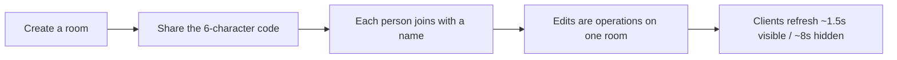

# TeamCompass

**Helps teams align on direction, review progress, and decide what comes next.**

TeamCompass is a shared collaboration room for three sprint rituals—**retrospective**, **sprint review**, and **roadmap scoring**. A team joins with a six-character code and edits one board together. The web app is the full room and hosts the API. The phone app joins the same rooms. There are no accounts.

| | |
| --- | --- |
| **Product brand** | TeamCompass |
| **Engineering packages** | `cadence` monorepo · `@cadence/core` · `@cadence/web` · `@cadence/mobile` |
| **Versions** | web/core `0.1.0` · mobile `1.0.0` |
| **Documentation hub** | [docs/00-INDEX.md](docs/00-INDEX.md) |

---

## Product overview

TeamCompass replaces scattered sticky notes, slides, and spreadsheets with one code-joined board per ritual:

1. **Retrospective** — Icebreaker → private notes → discuss → dot vote → owned actions → summary/CSV  
2. **Sprint review** — Shared readiness checklist, live feedback, one decision: ship / iterate / hold  
3. **Roadmap** — Score bets with RICE, ICE, or value÷complexity; complexity sits beside the business outcome  

### Product benefits

- **Fast start** — Create a room in seconds; share a short code  
- **Psychological safety** — Brainstorm notes stay private on the server until Discuss  
- **Facilitation control** — Host gates sections, icebreaker, discussion walk, and timers  
- **Clear closure** — Actions with owners; review decisions; roadmap quadrants  
- **Honest math** — Shared scoring in `@cadence/core` on web and mobile  
- **Exportable record** — Retro summary downloads as CSV  

---

## Features at a glance

| Area | Capabilities |
| --- | --- |
| Rooms | Create/join by code, local identity, presence (20s), optional demo seed, max 40 people |
| Retro | 34 templates, 18 icebreakers, privacy, discuss walks, votes (default 3), actions, timers 3/5/8, summary CSV |
| Review | Seeded checklist, multi-signer checks, goal, praise/change/question, ship·iterate·hold |
| Roadmap | RICE / ICE / value÷complexity, complexity index, median & 3.5 guides, quadrants, insights |
| Platforms | Next.js web + Expo mobile + shared TypeScript core |

Full product detail: [docs/PRODUCT.md](docs/PRODUCT.md) · Requirements: [docs/PRD.md](docs/PRD.md)

---

## Quick start

### Web

```bash
npm install
npm test
npm run dev
```

Open [http://localhost:3000](http://localhost:3000). Create a room, copy the code, and open it in another browser.

### Phone

The API must be the machine running the web app.

```bash
npm run dev
cd apps/mobile
npx expo start
```

On the phone home screen, set the server to your computer’s address (e.g. `http://192.168.1.20:3000`). A simulator on the same machine can use `http://localhost:3000`. Android emulators often need `http://10.0.2.2:3000`.

**Requirements:** Node.js ≥ 20.

---

## What’s in a room

### Retrospective

The host moves the room through six sections. Each section shows only its own work.

1. **Icebreaker** — Short warm-up (18 games). On This or That, the host can write the two sides.  
2. **Notes** — Classic and pop-culture templates; you see only your notes until Discuss. Column glyphs grow as notes collect.  
3. **Discuss** — Notes revealed; status walk or author walk.  
4. **Vote** — Dot budget (default 3, host sets 1–10). Notes are not editable while voting.  
5. **Actions** — Text, owner, done; can start from a note.  
6. **Summary** — Collect notes, dots, actions, icebreaker answers; download CSV (includes section timings).  

Each timed section has its own countdown (presets 3 / 5 / 8 minutes) and stopwatch.

### Sprint review

Shared checklist (increment, story, evidence, closing the loop), multi-signer checks, sprint goal, live feedback, and one release decision: **ship**, **iterate**, or **hold**.

### Roadmap

Initiatives carry outcome, assumption, score inputs, complexity (technical · dependency · uncertainty), horizon, and owner. High complexity starts at **3.5**. Strong score + high complexity = **big bet**; strong + lower complexity = **do first**.

Scoring variables and formulas: [docs/VARIABLES.md](docs/VARIABLES.md) · product detail: [docs/PRODUCT.md](docs/PRODUCT.md)

---

## Collaboration model



Votes and checks send the **desired state** (idempotent). During private brainstorm, the server removes other people’s note text before the response leaves. Text fields commit on blur or Enter; failed saves restore previous text.

Architecture: [docs/ARCHITECTURE.md](docs/ARCHITECTURE.md) · API: [docs/API.md](docs/API.md)

---

## Trust model

The room code is the only key. There are no accounts. Run TeamCompass on a **trusted network** (or accept that a public URL is code-gated only). Rooms live in a local JSON file on **one** Node process (`CADENCE_DATA_DIR/rooms.json`). That matches Docker / Render / Fly / a VPS—not Vercel Functions (those need Redis if used at all).

Full limitations: [docs/GUARDRAILS.md](docs/GUARDRAILS.md) · Deploy: [docs/DEPLOYMENT.md](docs/DEPLOYMENT.md)

---

## Tech stack

| Layer | Stack |
| --- | --- |
| Domain | TypeScript `@cadence/core`, Vitest |
| Web | Next.js 15, React 19, Instrument Sans, CSS tokens |
| Mobile | Expo ~58, React Native, AsyncStorage |
| Storage | Local JSON file on one process (preferred); optional Redis only for Vercel |

Details: [docs/TECH_STACK.md](docs/TECH_STACK.md)

---

## Repository layout

```
pm-collaboration/
├── packages/core     # Room rules, privacy, scoring, export (unit tested)
├── apps/web          # Next.js UI + room API + JSON store
├── apps/mobile       # Expo iOS/Android client
└── docs/             # Product documentation suite
```

---

## Documentation suite

| Document | Description |
| --- | --- |
| [docs/00-INDEX.md](docs/00-INDEX.md) | Documentation map |
| [docs/PRODUCT.md](docs/PRODUCT.md) | Full product documentation |
| [docs/PRD.md](docs/PRD.md) | Product requirements |
| [docs/personas/](docs/personas/) | User personas |
| [docs/user-stories/](docs/user-stories/) | Epics, stories, acceptance criteria |
| [docs/VARIABLES.md](docs/VARIABLES.md) | Variables, formulas, relationship charts |
| [docs/METRICS.md](docs/METRICS.md) | Product metrics & OKRs |
| [docs/DESIGN_GUIDELINES.md](docs/DESIGN_GUIDELINES.md) | Color palettes, components, themes |
| [docs/TRACEABILITY_MATRIX.md](docs/TRACEABILITY_MATRIX.md) | Requirements → code → tests |
| [docs/GUARDRAILS.md](docs/GUARDRAILS.md) | Technical & business limits |
| [docs/CHANGELOG.md](docs/CHANGELOG.md) | Historical development log |
| [docs/ARCHITECTURE.md](docs/ARCHITECTURE.md) | System design |
| [docs/TECH_STACK.md](docs/TECH_STACK.md) | Packages & environments |
| [docs/DEPLOYMENT.md](docs/DEPLOYMENT.md) | Single-process Docker / Render / Fly (file store) |
| [docs/API.md](docs/API.md) | HTTP & ops catalog |

---

## Deploy (local file store — preferred)

One Node process, no Redis:

```bash
docker build -t teamcompass .
docker run --rm -p 3000:3000 -v teamcompass-data:/data teamcompass
```

Or use **Render** (`render.yaml`) / **Fly.io** (`fly.toml`). Details: [docs/DEPLOYMENT.md](docs/DEPLOYMENT.md).

Avoid Vercel unless you add **Supabase** (or Redis)—Functions cannot keep a shared `rooms.json`. See [docs/DEPLOYMENT.md](docs/DEPLOYMENT.md) §7.

---

## Limits (summary)

- 40 people · 180 retro notes · 80 actions · 40 initiatives · 100 feedback notes  
- Room code = access control  
- One Node process owns the data file (Docker volume / disk for durability)  
- Last write wins on the same field  

---

## Testing

```bash
npm test   # @cadence/core + @cadence/web vitest suites
npm run build
```

Traceability of coverage: [docs/TRACEABILITY_MATRIX.md](docs/TRACEABILITY_MATRIX.md)

---

## Changelog

See [docs/CHANGELOG.md](docs/CHANGELOG.md) for historical development logs and version notes.
