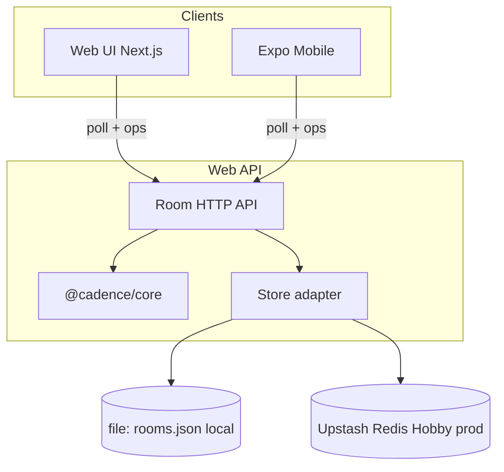

# TeamCompass — Architecture

**Last updated:** 2026-11-11  

---

## 1. System context

TeamCompass is a **monorepo** with a shared domain library and two clients that speak the same HTTP room API. There is no separate backend service; persistence is a document store (local JSON file or Upstash Redis on Vercel).

---

## 2. Package layout

| Path | Package | Responsibility |
| --- | --- | --- |
| `packages/core` | `@cadence/core` | Types, `createRoom`, `applyOp`, `presentRoom`, scoring, content, retro export, validation |
| `apps/web` | `@cadence/web` | Next.js App Router UI, API routes, JSON persistence, HTTP helpers |
| `apps/mobile` | `@cadence/mobile` | Expo RN client (not in root workspaces; depends via `file:../../packages/core`) |

Root `package.json` workspaces: `packages/core`, `apps/web` only.

---

## 3. Domain model (summary)

A **Room** has `code`, `kind`, `title`, timestamps, monotonic `version`, `hostId`, `participants`, and exactly one of `retro` | `review` | `roadmap` populated by kind.

Mutations are **Ops** (discriminated union). The server:

1. Loads room from store  
2. Validates actor membership  
3. Applies `applyOp` in core  
4. Persists and returns `presentRoom(room, actorId)`  

`presentRoom` adds `active` flags, card view fields (`voteCount`, `hidden`, `mine`), and **strips private brainstorm content** for non-authors.

---

## 4. Sync model

| Mechanism | Behavior |
| --- | --- |
| Transport | HTTP JSON |
| Freshness | Client poll: **1500 ms** when document visible, **8000 ms** when hidden (`use-room.ts`) |
| Concurrency | Last write wins on overlapping fields |
| Versioning | Clients ignore snapshots older than local `version` |
| Presence | `markSeen` on get/join/ops; throttle skips writes if seen &lt; 5s ago |
| Idempotency | Votes/checks send desired boolean state |

Not used: WebSockets, CRDTs, OT, or offline queues beyond optimistic local text fields.

---

## 5. Privacy model

| Phase / surface | Rule |
| --- | --- |
| Brainstorm notes | Other authors’ `body` / identity hidden in `RoomView` until Discuss |
| Discuss onward | Notes revealed per phase rules |
| Server operator | Can read file store or Redis document — trust the host environment |
| Transport | No end-to-end encryption; use trusted network |

---

## 6. Persistence

`apps/web/src/server/store.ts` + `persistence.ts`:

- **Backends:** `file` (local default) or `redis` (auto when Upstash env is set; required on Vercel)  
- Document shape unchanged: `{ rooms: Record<code, Room> }`  
- In-process serialization queue  
- Distributed-ish lock: file lock locally, Redis `SET NX` + TTL on Hobby  
- Stale lock recovery (~5s); busy error after ~4s wait  
- Room codes: 6 chars from alphabet excluding ambiguous `I`, `O`, `0`, `1`  

**Implication:** file backend needs one writer process. Redis backend is required for Vercel Functions. See [DEPLOYMENT.md](./DEPLOYMENT.md).

---

## 7. API surface (high level)

| Method | Path | Purpose |
| --- | --- | --- |
| POST | `/api/rooms` | Create |
| GET | `/api/rooms/[code]` | Snapshot (+ optional actor presence) |
| POST | `/api/rooms/[code]/join` | Join |
| POST | `/api/rooms/[code]/ops` | Apply op |

All routes: `force-dynamic`, Node runtime, CORS `*`, `Cache-Control: no-store`.  
Details: [API.md](./API.md).

---

## 8. Web UI composition

| Route | Component |
| --- | --- |
| `/` | `HomeScreen` |
| `/new` | `NewRoomForm` |
| `/r/[code]` | `RoomApp` → `RetroBoard` / `ReviewBoard` / `RoadmapBoard` |

Supporting modules: `use-room.ts` (poll + serialized ops), `identity.ts`, `shared-field.tsx`, `icebreaker-panel.tsx`, `retro-ui.ts`, glyphs.

---

## 9. Mobile composition

Single-entry `App.js` screens: home → create → room. API client in `src/api.js`. Visual tokens in `src/ui.js`. Configurable API base URL required for device ↔ host connectivity.

---

## 10. Error architecture

Domain failures throw `CadenceError` with `code` (e.g. `missing`, `host`, `phase`, `private`, `votes`, `limit`, `store`). HTTP layer maps `missing` → 404, other known domain codes → 400, unexpected → 500. Clients surface user-readable messages.

---

## 11. Testing architecture

| Layer | Location |
| --- | --- |
| Core domain | `packages/core/src/*.test.ts` |
| Web helpers | `retro-ui.test.ts`, `retro-glyphs.test.ts` |
| Gaps | API/store E2E, full React component E2E, mobile automation |

---

## 12. Security architecture (honest scope)

TeamCompass is designed as a **trusted-network collaboration tool**, not a hardened multi-tenant SaaS. See [GUARDRAILS.md](./GUARDRAILS.md).
