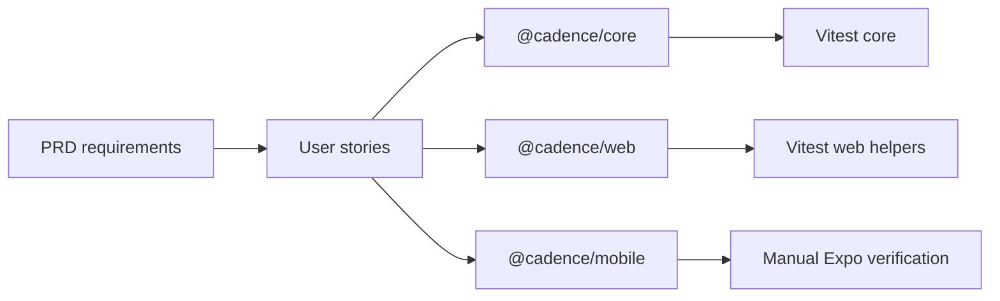

# TeamCompass — Enterprise Traceability Matrix

**Document type:** Requirements ↔ Stories ↔ Implementation ↔ Verification  
**Product:** TeamCompass (`@cadence/*`)  
**Last updated:** 2026-11-12  

---

## 1. How to read this matrix

| Column | Meaning |
| --- | --- |
| Req ID | From [PRD.md](./PRD.md) |
| Story | From [user-stories/](./user-stories/) |
| Implementation | Primary source paths |
| Verification | Tests or manual proof |
| Status | `Implemented` relative to current repo |

---

## 2. Room lifecycle

| Req ID | Requirement (short) | Story | Implementation | Verification | Status |
| --- | --- | --- | --- | --- | --- |
| FR-R1 | Create ritual room | US-1.1 | `api/rooms/route.ts`, `new-room-form.tsx`, `createRoom` | `room.test.ts` create flows | Implemented |
| FR-R2 | 6-char code | US-1.1 | `store.ts` `makeCode` | Manual + create API | Implemented |
| FR-R3 | Join with code + name | US-1.2 | `…/join/route.ts`, `room-app.tsx` | Core join + full room | Implemented |
| FR-R4 | Persist identity | US-1.3 | `identity.ts`, mobile AsyncStorage | Manual | Implemented |
| FR-R5 | Active presence 20s | US-1.4 | `ACTIVE_MS`, `presentRoom` | Core presence assertions | Implemented |
| FR-R6 | Rename room/self | US-1.5 | `room.rename`, `presence.rename` | `parseOp` / apply tests | Implemented |
| FR-R7 | Demo seed | US-1.6 | `fillDemo` | Manual / demo create | Implemented |
| FR-R8 | Hard limits | US-1.2, US-2.6, US-4.6 | `LIMITS` + throws | Limit tests in `room.test.ts` | Implemented |

---

## 3. Retrospective

| Req ID | Requirement (short) | Story | Implementation | Verification | Status |
| --- | --- | --- | --- | --- | --- |
| FR-RET1 | Host-gated phases | US-2.9 | `retro.setPhase`, `retro-board.tsx` | Host gate tests | Implemented |
| FR-RET2 | 34 templates | US-2.1 | `content.ts` `RETRO_TEMPLATES` | Template coverage tests | Implemented |
| FR-RET3 | Brainstorm privacy | US-2.3 | `presentRoom` | Privacy tests | Implemented |
| FR-RET4 | 18 icebreakers | US-2.2 | `ICEBREAKERS`, `icebreaker-panel.tsx` | Icebreaker tests | Implemented |
| FR-RET5 | Custom This/That pairs | US-2.2 | `setIcebreakerPairs` | Pair validation tests | Implemented |
| FR-RET6 | Discuss walks | US-2.4 | `setDiscussionBy`, `focusGroup` | Discuss walk tests | Implemented |
| FR-RET7 | Dot voting budget | US-2.5 | `vote`, `setVotesPerPerson` | Vote tests | Implemented |
| FR-RET8 | Actions + owners | US-2.6 | action ops, Actions UI | Action tests | Implemented |
| FR-RET9 | Timers + stopwatch | US-2.7 | `timers`, `stopwatchMs`, `PhaseTimer` | Timer/stopwatch tests | Implemented |
| FR-RET10 | Summary + CSV | US-2.8 | `retro-export.ts`, summary UI | `retro-export.test.ts` | Implemented |
| FR-RET11 | Column glyphs | — | `retro-glyphs.tsx` | `retro-glyphs.test.ts` | Implemented |
| FR-RET12 | Discuss raise hand | US-2.4b | `retro.raiseHand`, `raisedHands`, web+mobile Discuss UI | `room.test.ts` raise-hand cases | Implemented |

---

## 4. Sprint review

| Req ID | Requirement (short) | Story | Implementation | Verification | Status |
| --- | --- | --- | --- | --- | --- |
| FR-REV1 | Seeded checklist | US-3.1 | `createReviewState`, `review-board.tsx` | Review checklist tests | Implemented |
| FR-REV2 | Multi-signer checks | US-3.2 | `review.setItemDone` | Desired-state tests | Implemented |
| FR-REV3 | Notes + custom items | US-3.3 | `setItemNote`, `addItem` | Core tests | Implemented |
| FR-REV4 | Sprint goal | US-3.4 | `setGoal` | Core tests | Implemented |
| FR-REV5 | Feedback kinds | US-3.5 | feedback ops | Core tests | Implemented |
| FR-REV6 | Release decision | US-3.6 | `setDecision`, notes | Core tests | Implemented |

---

## 5. Roadmap

| Req ID | Requirement (short) | Story | Implementation | Verification | Status |
| --- | --- | --- | --- | --- | --- |
| FR-RM1 | RICE / ICE / value-complexity | US-4.1, US-4.3 | `scoring.ts`, `roadmap-board.tsx` | Scoring tests | Implemented |
| FR-RM2 | Complexity average | US-4.3, US-4.4 | `complexityIndex` | Scoring tests | Implemented |
| FR-RM3 | Chart guides 3.5 + median | US-4.4 | `roadmap-board.tsx` chart | Manual + unit median | Implemented |
| FR-RM4 | Quadrants + insights | US-4.4 | `quadrantFor`, `insightFor` | Quadrant tests | Implemented |
| FR-RM5 | Horizon + owner | US-4.5 | `Initiative` patch | Patch validation | Implemented |
| FR-RM6 | Objective field | US-4.2 | `setObjective` | Core | Implemented |

---

## 6. Platforms & NFRs

| Req ID | Requirement (short) | Story | Implementation | Verification | Status |
| --- | --- | --- | --- | --- | --- |
| FR-P1 | Web UI + API | US-5.1 | `apps/web` | Manual smoke + vitest helpers | Implemented |
| FR-P2 | Mobile client | US-5.2 | `apps/mobile` | Manual Expo smoke | Implemented |
| FR-P3 | Shared core | US-5.3 | `packages/core` | `npm test -w @cadence/core` | Implemented |
| FR-P4 | HTTP API surface | US-5.1 | `app/api/rooms/**` | Manual / integration gap | Implemented (API tests thin) |
| FR-P5 | Polling sync | US-5.4 | `use-room.ts` | Manual | Implemented |
| NFR-1 | Vitest domain coverage | US-5.3 | `*.test.ts` | CI/`npm test` | Implemented |
| NFR-2 | Body size cap | — | `http.ts` | Manual | Implemented |
| NFR-3 | Durable shared store | — | `store.ts`, `persistence.ts` | File / Supabase / Redis selection + `store.test.ts` | Implemented |
| NFR-Hobby | Vercel Hobby deploy | — | `DEPLOYMENT.md`, `supabase-schema.sql`, optional Upstash | Build + Supabase or Redis env | Implemented |
| NFR-4 | A11y basics | US-5.1 | skip link, focus-visible | Manual | Implemented |
| NFR-5 | Domain error UX | — | `CadenceError` mapping | Tests throw codes | Implemented |
| NFR-6 | No secrets in repo | — | `.gitignore` data path | Review | Implemented |
| NFR-7 | Node ≥ 20 | — | root `engines` | Environment | Implemented |

---

## 7. Coverage gaps (explicit)

| Gap | Risk | Recommended follow-up |
| --- | --- | --- |
| No automated API/store route tests | Regressions in HTTP mapping | Add Vitest/supertest or route unit tests |
| No E2E browser suite | UI regression | Playwright smoke: create→join→note |
| No mobile automated tests | Mobile drift | Detox/Maestro critical path |
| Analytics not implemented | OKRs qualitative only | See [METRICS.md](./METRICS.md) |

---

## 8. Requirement → package map

---

## 9. Change control

When a requirement changes:

1. Update PRD row  
2. Update or add user story acceptance criteria  
3. Update this matrix row (implementation + verification)  
4. Add [CHANGELOG](./CHANGELOG.md) entry  
5. Ensure tests exist or file an explicit gap  
