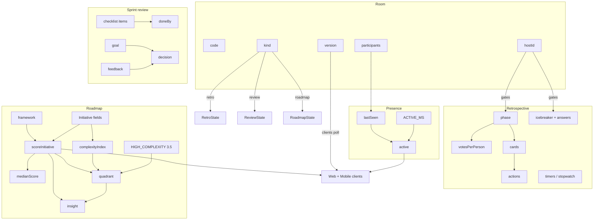
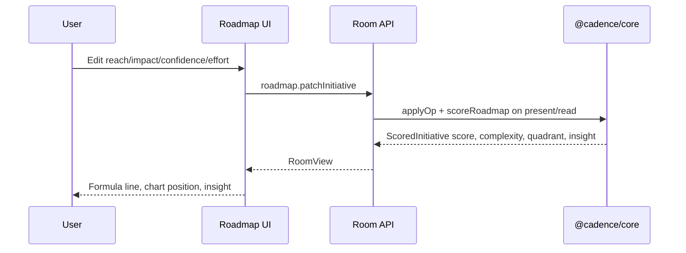

# TeamCompass — Variables Documentation

**Purpose:** Exhaustive catalog of product and domain variables used across TeamCompass.  
**Format:** Variable name · Friendly name · Definition · Formula / rule · Location · Example  
**Source of truth:** `packages/core/src/{types,scoring,room,text,content,ids}.ts`, web/mobile clients  
**Last updated:** 2026-11-11  

---

## 1. How to use this document

1. Find a variable by name in the tables below.  
2. Use **Friendly name** in product conversations and UI copy reviews.  
3. Use **Formula / rule** when changing scoring, limits, or sync.  
4. Use **Location** to jump to implementation.  
5. See **§10 Relationship chart** for how variables connect in flows.  
6. Deploy/store env vars are in **§11** (Hobby / Upstash).

---

## 2. Room envelope variables

| Variable name | Friendly name | Definition | Formula / rule | Location in the apps | Example |
| --- | --- | --- | --- | --- | --- |
| `code` | Room code | Six-character public join key for the room | Alphabet `ABCDEFGHJKLMNPQRSTUVWXYZ23456789` (excludes I, O, 0, 1); unique in store | `store.ts` `makeCode`; home join; `/r/[code]` | `K7M9QX` |
| `kind` | Ritual type | Which board the room hosts | Enum: `retro` \| `review` \| `roadmap` | Create form; `Room.kind`; home ritual cards | `retro` |
| `title` | Room title | Human label for the meeting | Cleaned line; max `LIMITS.title` (80) | `room.rename`; room header | `Sprint 42 Retro` |
| `version` | Room version | Monotonic revision counter for sync | Increments on successful mutation; clients ignore older snapshots | `Room.version`; `use-room.ts` | `17` |
| `hostId` | Host participant id | Participant who owns facilitation privileges | Set at create; host-gated ops compare actor to `hostOf(room)` | `Room.hostId`; phase/icebreaker ops | `person_a1b2c3d4e5f67890` |
| `createdAt` / `updatedAt` | Created / updated timestamps | ISO timestamps for audit of room lifecycle | Set/updated on create and each write | `Room` | `2026-11-06T12:00:00.000Z` |
| `participants` | People in the room | List of joined participants | Length ≤ `LIMITS.participants` (40) | Join API; people strip in `room-app` | 6 people |

---

## 3. Participant & presence variables

| Variable name | Friendly name | Definition | Formula / rule | Location | Example |
| --- | --- | --- | --- | --- | --- |
| `Participant.id` | Person id | Stable actor identity | `person_` + hex; pattern `[A-Za-z0-9_-]{8,80}` | `identity.ts`; mobile storage; join body | `person_0f1e2d3c4b5a6978` |
| `Participant.name` | Display name | Name shown in the room | `cleanName`; max 40 | Join; `presence.rename` | `Jordan` |
| `Participant.color` | Avatar color | Color assigned at join | `PALETTE[index % 8]` | `makeParticipant` in `room.ts` | `#1f5f73` |
| `Participant.lastSeen` | Last seen time | Last activity timestamp | ISO string updated on get/join/ops | Store / `markSeen` | `2026-11-11T10:01:02.000Z` |
| `ParticipantView.active` | Active now | Whether the person appears online | `now - lastSeen ≤ ACTIVE_MS` where `ACTIVE_MS = 20_000` | `presentRoom` | `true` |
| `ACTIVE_MS` | Presence window | Milliseconds after which a person is inactive | Constant **20000** | `types.ts` | 20 seconds |
| Presence write throttle | Presence throttle | Skip redundant lastSeen writes | Skip if last mark &lt; **5000** ms ago | `room.ts` `markSeen` | — |

**Palette (`PALETTE`):** `#c2512c`, `#1f5f73`, `#2f6b52`, `#8a5a12`, `#6b3f69`, `#3d4c2f`, `#8d3d4a`, `#3f5f8a`

---

## 4. Hard limits (`LIMITS`)

| Variable name | Friendly name | Definition | Formula / rule | Location | Example |
| --- | --- | --- | --- | --- | --- |
| `LIMITS.participants` | Max people | Maximum participants per room | 40 | Join / create | Room rejects 41st join |
| `LIMITS.cards` | Max retro notes | Maximum cards on a retro board | 180 | `retro.addCard` | — |
| `LIMITS.actions` | Max actions | Maximum action items | 80 | `retro.addAction` | — |
| `LIMITS.icebreakerAnswers` | Max icebreaker answers | Cap on icebreaker submissions | 240 | `retro.answerIcebreaker` | — |
| `LIMITS.icebreakerPairs` | Max This-or-That pairs | Cap on host-written pairs | 8 | `setIcebreakerPairs` | 5 pairs |
| `LIMITS.icebreakerQuestion` | Max pair question length | Generated/cleaned question length | 90 | Pair normalization | — |
| `LIMITS.icebreakerSide` | Max pair side label | Left/right side text length | 40 | Pair normalization | `Ship it` |
| `LIMITS.icebreakerWord` | Max one-word answer | Single-word icebreaker length | 24 | one-word games | `focused` |
| `LIMITS.icebreakerShout` | Max shout-out length | Shout-out body length | 140 | shout-out game | — |
| `LIMITS.icebreakerLine` | Max line answer | Default icebreaker line length | 180 | many games | — |
| `LIMITS.icebreakerDrawing` | Max drawing payload | Drawing serialization length | 6000 | draw game | `d:…` |
| `LIMITS.icebreakerGif` | Max GIF URL length | HTTPS GIF URL head length | 400 | gif game | — |
| `LIMITS.notes` | Max review feedback | Feedback list cap | 100 | `review.addFeedback` | — |
| `LIMITS.itemsPerSection` | Max checklist items / section | Custom + seeded items per section | 30 | `review.addItem` | — |
| `LIMITS.initiatives` | Max initiatives | Roadmap bets per room | 40 | `roadmap.addInitiative` | — |
| `LIMITS.title` | Max room title | Title character cap | 80 | rename / create | — |
| `LIMITS.name` | Max person name | Name character cap | 40 | join / rename | — |
| `LIMITS.card` | Max note/action body | Card and action text cap | 500 | cards / actions | — |
| `LIMITS.goal` | Max sprint goal | Review goal length | 240 | `review.setGoal` | — |
| `LIMITS.note` | Max checklist item note | Evidence note length | 800 | `setItemNote` | — |
| `LIMITS.feedback` | Max feedback body | Feedback character cap | 500 | add feedback | — |
| `LIMITS.decisionNotes` | Max decision notes | Release decision notes | 2000 | `setDecisionNotes` | — |
| `LIMITS.objective` | Max roadmap objective | Board objective length | 240 | `setObjective` | — |
| `LIMITS.initiativeTitle` | Max initiative title | Bet title length | 120 | patch | — |
| `LIMITS.outcome` | Max outcome text | Business outcome length | 400 | patch | — |
| `LIMITS.assumption` | Max assumption text | Hypothesis length | 400 | patch | — |

---

## 5. Retrospective variables

| Variable name | Friendly name | Definition | Formula / rule | Location | Example |
| --- | --- | --- | --- | --- | --- |
| `templateId` | Retro template | Column shape for the board | One of 34 `RetroTemplateId` values | Create; `RetroState` | `start-stop-continue` |
| `phase` | Retro section | Current facilitation section | `icebreak` \| `brainstorm` \| `vote` \| `discuss` \| `act` \| `summary`; UI order icebreak → brainstorm → **discuss** → vote → act → summary | Host `setPhase`; boards | `discuss` |
| `votesPerPerson` | Dot budget | Dots each person may place | Integer **1–10**; default **3**; lowering drops newest excess | Vote tools | `3` |
| `votes left` | Votes remaining | Dots still available to actor | `max(0, votesPerPerson - votesUsed)` | `room.ts` / UI | `1` |
| `timers[phase]` | Section countdown end | ISO end time for section timer | Start clamps seconds **30–3600**; UI presets **180 / 300 / 480** s | `startTimer` / `PhaseTimer` | ends in 5 min |
| `timerEndsAt` | Legacy timer mirror | Deprecated mirror of current phase timer | Kept for older clients | `RetroState` | — |
| `stopwatchMs[phase]` | Section stopwatch | Accrued ms while section was active | Increases while section open; Summary has none | `sectionStopwatchMs` | `320000` |
| `stopwatchRunningSince` | Stopwatch start | When current section stopwatch began | ISO or null | `RetroState` | — |
| `columns[]` | Board columns | Status categories | From template; each has `id`, `title`, `hint`, `tone` | Templates / board | Start / Stop / Continue |
| `ColumnTone` | Column tone | Semantic color family | `good` \| `bad` \| `idea` \| `neutral` | CSS `.tone-*` | `good` → sage |
| `cards[]` | Notes | Retro notes | Cap 180; fields below | Brainstorm UI | — |
| `RetroCard.body` | Note text | Content of a note | Max 500; private in brainstorm for others | Cards | `Deploy pipeline flaky` |
| `RetroCard.anonymous` | Anonymous note | Hide author identity when revealed | Boolean | Add card | `true` |
| `RetroCard.votes` | Voters list | Participant ids who dotted this note | Desired-state add/remove | Vote phase | `["person_…"]` |
| `voteCount` | Dot count | Number of votes on a note (view) | `votes.length` | `RetroCardView` | `4` |
| `hidden` / `mine` | Privacy flags | Whether body is hidden; whether card is mine | Set in `presentRoom` | Card view | `hidden: true` |
| `discussedCardId` | Focused note | Note in discuss focus | Card id or null | Discuss UI | — |
| `discussionBy` | Discuss walk mode | How the host walks the board | `status` \| `author` | Host control | `author` |
| `discussedGroupKey` | Focused group | Current column, author, or `anonymous` | Validated against board | `focusGroup` | column id |
| `icebreaker` | Icebreaker game | Active warm-up game id | One of 18 `IcebreakerId` | Host picker | `this-or-that` |
| `icebreakerRound` | Icebreaker round | Round index for multi-round games | Integer advanced by host | Ops | `2` |
| `icebreakerPairs` | Custom pairs | Host-written This or That pairs | 1–8 pairs; sides distinct; question derived | Host editor | left/right labels |
| `icebreakerAnswers` | Icebreaker answers | Submissions for the game | Cap 240; game-specific body rules | Panel | — |
| `ActionItem.body` | Action text | Follow-up work item | Max 500 | Actions panel | `Fix flaky deploy` |
| `ActionItem.ownerId` | Action owner | Assignee participant or null | Must be in room if set | Assign control | `person_…` |
| `ActionItem.done` | Action done | Completion flag | Desired boolean | Checkbox | `false` |
| `ActionItem.sourceCardId` | Source note | Note this action came from | Unique per note when set | Add from note | `card_…` |

**Timer presets (UI):** 3, 5, 8 minutes → 180, 300, 480 seconds (`TIMER_PRESETS` in `retro-board.tsx`).

---

## 6. Sprint review variables

| Variable name | Friendly name | Definition | Formula / rule | Location | Example |
| --- | --- | --- | --- | --- | --- |
| `goal` | Sprint goal | Shared goal for the review | Max 240 | Review board | `Reduce checkout latency` |
| `sections[]` | Checklist sections | Grouped readiness criteria | Seeded at create | `createReviewState` | Increment / Story / … |
| `ChecklistItem.required` | Required item | Whether item counts for readiness | Boolean | Checklist | `true` |
| `ChecklistItem.doneBy` | Signers | Participants who checked the item | Desired-state membership for actor | Checks | two ids |
| `ChecklistItem.note` | Evidence note | Supporting note on an item | Max 800 | Item note field | `See PR #412` |
| `checklistProgress` | Checklist progress | Share of required items with ≥1 signer | UI helper over required items | Review header | `75%` |
| `feedback[]` | Feedback notes | Live feedback list | Cap 100 | Feedback panel | — |
| `FeedbackKind` | Feedback kind | Tag on feedback | `praise` \| `change` \| `question` | Chips | `change` |
| `decision` | Release decision | Outcome of the review | `ship` \| `iterate` \| `hold` \| `null` | Decision control | `iterate` |
| `decisionNotes` | Decision notes | Rationale for the decision | Max 2000 | Notes field | `Need a11y pass` |

---

## 7. Roadmap & scoring variables

| Variable name | Friendly name | Definition | Formula / rule | Location | Example |
| --- | --- | --- | --- | --- | --- |
| `framework` | Scoring framework | Active prioritization model | `rice` \| `ice` \| `value-complexity` | Framework switch | `rice` |
| `objective` | Roadmap objective | Board-level objective | Max 240 | Objective field | `Grow activated teams` |
| `Initiative.title` | Initiative title | Name of the bet | Max 120 | Card | `Self-serve invites` |
| `Initiative.outcome` | Business outcome | Intended business result | Max 400 | Card | `+15% invites sent` |
| `Initiative.assumption` | Assumption | Hypothesis behind the bet | Max 400 | Card | `Friction is awareness` |
| `reach` | Reach | People/accounts affected this quarter | Integer **0–1_000_000** | RICE inputs | `400` |
| `impact` | Impact | Intercom RICE impact level | **0.25 \| 0.5 \| 1 \| 2 \| 3** (`IMPACT_OPTIONS`) | RICE inputs | `2` (High) |
| `confidence` | Confidence | Belief the outcome will happen | **0–1**, 2-decimal clamp | RICE inputs | `0.8` |
| `effort` | Effort | Person-months of team time | **0.25–240**; if ≤0 score=0 | RICE inputs | `2` |
| **RICE score** | RICE score | Prioritization score | `(reach × impact × confidence) / effort` | `scoreInitiative` | `(400×2×0.8)/2 = 320` |
| `iceImpact` | ICE impact | ICE impact 1–10 | Integer 1–10 | ICE inputs | `7` |
| `iceConfidence` | ICE confidence | ICE confidence 1–10 | Integer 1–10 | ICE inputs | `6` |
| `iceEase` | ICE ease | Ease to ship 1–10 | Integer 1–10 | ICE inputs | `8` |
| **ICE score** | ICE score | Growth-style score | `iceImpact × iceConfidence × iceEase` | `scoreInitiative` | `7×6×8 = 336` |
| `value` | Business value | Value 1–10 for value/complexity | Integer 1–10 | Value inputs | `8` |
| `complexityTechnical` | Technical complexity | Engineering difficulty 1–5 | Integer 1–5 | Complexity inputs | `4` |
| `complexityDependency` | Dependency load | Dependency difficulty 1–5 | Integer 1–5 | Complexity inputs | `3` |
| `complexityUncertainty` | Uncertainty | Uncertainty 1–5 | Integer 1–5 | Complexity inputs | `4` |
| **complexity index** | Complexity index | Average complexity | `round(((T+D+U)/3)×100)/100` | `complexityIndex` | `(4+3+4)/3 = 3.67` |
| **Value÷complexity score** | Value / complexity score | Outcome-vs-difficulty score | `value / complexityIndex` (0 if complexity ≤0) | `scoreInitiative` | `8 / 3.67 ≈ 2.2` |
| `HIGH_COMPLEXITY` | High complexity threshold | Vertical guide / “heavy” cut | Constant **3.5** | `types.ts`; chart | `3.5` |
| **score median** | Median score | Horizontal guide / “strong” cut | Classic median of initiative scores (even → avg of middle two) | `medianScore` | e.g. `120` |
| `quadrant` | Quadrant | Score×complexity bucket | strong=`score≥median`; heavy=`complexity≥3.5` → see matrix | `quadrantFor` | `big-bet` |
| `rank` | Rank | Order by score desc then title | 1-based after sort | `ScoredInitiative` | `1` |
| `bar` | Relative bar | Score relative to max on board | `score / max(1, maxScore)` | List UI | `0.85` |
| `horizon` | Horizon | Sequencing bucket | `now` \| `next` \| `later` | Card | `next` |
| `ownerId` | Initiative owner | Owner participant or null | Must exist in room if set | Card | `person_…` |
| Thin confidence insight | Thin confidence | Warning when RICE confidence is low | Trigger if `confidence < 0.6` | `insightFor` | Warn copy |
| Narrow reach insight | Narrow reach for effort | Warning for expensive low-reach bets | Trigger if `reach < 50` and `effort ≥ 3` | `insightFor` | Warn copy |

### Quadrant matrix

| Strong (score ≥ median) | Heavy (complexity ≥ 3.5) | Quadrant | Friendly label |
| --- | --- | --- | --- |
| Yes | No | `do-first` | Do first |
| Yes | Yes | `big-bet` | Big bet |
| No | No | `fill-in` | Fill-in |
| No | Yes | `reconsider` | Reconsider |

### Default blank initiative (create)

reach 100 · impact 1 · confidence 0.8 · effort 1 · ICE 5/5/5 · value 5 · complexity 3/3/3 · horizon `next`

---

## 8. Sync, HTTP, and identity helpers

| Variable name | Friendly name | Definition | Formula / rule | Location | Example |
| --- | --- | --- | --- | --- | --- |
| Poll interval (visible) | Live refresh interval | How often clients refetch when tab visible | **1500** ms | `use-room.ts` | 1.5s |
| Poll interval (hidden) | Background refresh | Refetch when tab hidden | **8000** ms | `use-room.ts` | 8s |
| Request body limit | Max request body | JSON body character cap | **100_000** | `http.ts` | — |
| Store lock stale | Stale lock window | When a file lock is considered abandoned | ~**5** s | `store.ts` | — |
| Store busy wait | Store busy timeout | When to error if lock not acquired | ~**4** s → `store` error | `store.ts` | — |
| `createId(prefix)` | Entity id | Prefixed random id | `` `${prefix}_${uuid12}` `` | `ids.ts` | `card_…` |
| Drawing payload | Drawing strokes | Canvas icebreaker encoding | `d:` + strokes; ≤80 strokes; 2–200 pts; coords 0–100 | `normalizeDrawing` | — |
| Two truths body | Truths payload | Three statements + lie marker | 3 lines + `#1|#2|#3`; statement ≤120 | `normalizeTruths` | — |
| `truthDisplayOrder` | Truth shuffle | Viewer order so lie position is not fixed | FNV-ish shuffle of `[0,1,2]` from seed | `content.ts` | `[2,0,1]` |

---

## 9. Design token variables (product-facing)

See [DESIGN_GUIDELINES.md](./DESIGN_GUIDELINES.md) for full palettes. Core semantic tokens:

| Token | Friendly name | Value | Use |
| --- | --- | --- | --- |
| `--ink` | Primary ink | `#12141a` | Text, primary buttons |
| `--ink-soft` | Soft ink | `#5c6573` | Secondary text |
| `--paper` | Page paper | `#f4f5f7` | Page wash / themeColor |
| `--accent` / `--terra` | Accent | `#e23b16` | Brand accent |
| `--sage` | Positive | `#0d7a45` | Good tone |
| `--sea` | Idea / focus | `#1d4ed8` | Idea tone, focus ring |
| `--gold` | Neutral warn | `#9a6700` | Neutral tone |
| `--bad` | Negative | `#c4233a` | Bad tone / errors |

---

## 10. Relationship chart

### Usage flow (scoring path)

---

## 11. Deployment / store environment variables

| Variable name | Friendly name | Definition | Formula / rule | Location | Example |
| --- | --- | --- | --- | --- | --- |
| `CADENCE_STORE` | Store backend override | Forces file or Redis persistence | `file` \| `redis`; omit → auto | `persistence.ts` `resolveStoreBackend` | `redis` |
| `CADENCE_DATA_DIR` | Local data directory | Directory for `rooms.json` / lock | Defaults to `process.cwd()/data` | `persistence.ts` | `/tmp/cadence-data` |
| `UPSTASH_REDIS_REST_URL` | Upstash REST URL | Redis HTTP endpoint for Hobby | Required with token when backend is redis | Vercel env; Marketplace | `https://….upstash.io` |
| `UPSTASH_REDIS_REST_TOKEN` | Upstash REST token | Auth for Redis REST | Required with URL when backend is redis | Vercel env; Marketplace | (secret) |
| `cadence:rooms` | Redis rooms key | Document key for `{ rooms }` JSON | Whole-DB document | `persistence.ts` | Redis JSON value |
| `cadence:rooms:lock` | Redis lock key | Mutual exclusion while mutating | `SET NX` + ~5s TTL | `persistence.ts` | lock token string |

---

## 12. Maintenance

When adding a variable:

1. Add it to `types.ts` or the owning module.  
2. Add a row to this document with all six columns.  
3. Update the Mermaid chart if it participates in a cross-feature relationship.  
4. Note the change in [CHANGELOG.md](./CHANGELOG.md).
