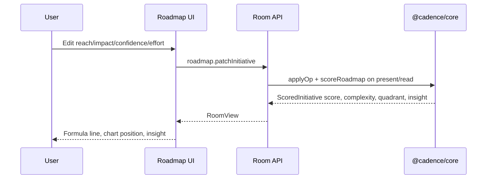
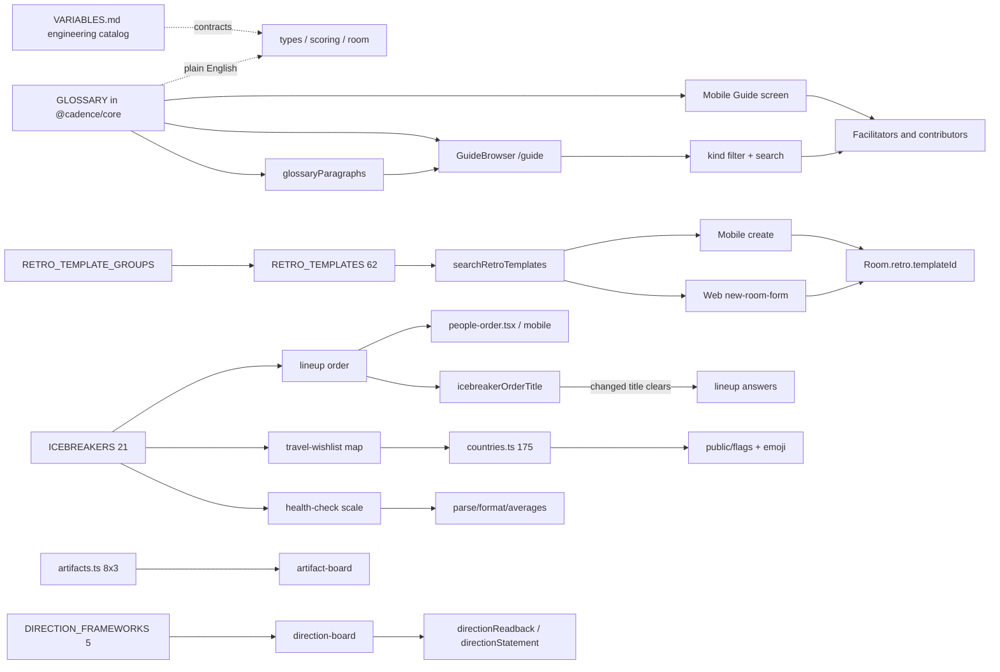
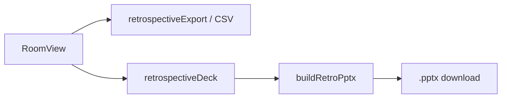
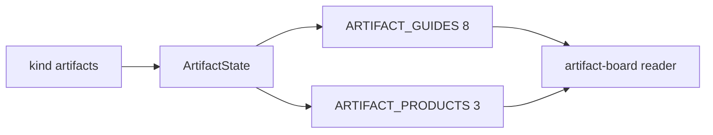

# TeamCompass — Variables Documentation

**Purpose:** Exhaustive catalog of product and domain variables used across TeamCompass.  
**Format:** Variable name · Friendly name · Definition · Formula / rule · Location · Example  
**Source of truth:** `packages/core/src/{types,scoring,room,text,content,artifacts,countries,ids,glossary,retro-export,retro-deck}.ts`, `apps/web/src/lib/retro-pptx.ts`, web/mobile clients  
**Last updated:** 2026-11-23 (Definitions browser + glossary prose)  

In-app Definitions for facilitators and contributors live in `packages/core/src/glossary.ts` (`GLOSSARY`) and render on web `/guide` and the mobile Guide screen. This file remains the **engineering** catalog (limits, sync, store env, CSV columns). Prefer updating `GLOSSARY` when changing user-facing wording; prefer updating this file when changing contracts.

---

## 1. How to use this document

1. Find a variable by name in the tables below.  
2. Use **Friendly name** in product conversations and UI copy reviews.  
3. Use **Formula / rule** when changing scoring, limits, or sync.  
4. Use **Location** to jump to implementation.  
5. See **§10 Relationship chart** for how variables connect in flows.  
6. Deploy/store env vars are in **§11** (file / Supabase / Redis).  
7. In-app glossary inventory is **§12**; retro CSV columns are **§13**.

---

## 2. Room envelope variables

| Variable name | Friendly name | Definition | Formula / rule | Location in the apps | Example |
| --- | --- | --- | --- | --- | --- |
| `code` | Room code | Six-character public join key for the room | Alphabet `ABCDEFGHJKLMNPQRSTUVWXYZ23456789` (excludes I, O, 0, 1); unique in store | `store.ts` `makeCode`; home join; `/r/[code]` | `K7M9QX` |
| `kind` | Ritual type | Which board the room hosts | Enum: `retro` \| `planning` \| `refinement` \| `review` \| `roadmap` \| `direction` \| `prd` \| `artifacts` | Create form; `Room.kind`; home ritual cards; `RITUALS` | `prd` |
| `title` | Room title | Human label for the meeting | Cleaned line; max `LIMITS.title` (80) | `room.rename`; room header | `Sprint 42 Retro` |
| `version` | Room version | Monotonic revision counter for sync | Increments on successful mutation; clients ignore older snapshots | `Room.version`; `use-room.ts` | `17` |
| `hostId` | Host participant id | Participant who owns facilitation privileges | Set at create; host-gated ops compare actor to `hostOf(room)` | `Room.hostId`; phase/icebreaker ops | `person_a1b2c3d4e5f67890` |
| `createdAt` / `updatedAt` | Created / updated timestamps | ISO timestamps for audit of room lifecycle | Set/updated on create and each write | `Room` | `2026-11-06T12:00:00.000Z` |
| `participants` | People in the room | List of joined participants | Length ≤ `LIMITS.participants` (40) | Join API; people strip in `room-app` | 6 people |

---

## 3. Participant & presence variables

| Variable name | Friendly name | Definition | Formula / rule | Location | Example |
| --- | --- | --- | --- | --- | --- |
| `Participant.id` | Person id | Stable actor identity | `person_` + hex; pattern `[A-Za-z0-9_-]{8,80}` | `identity.ts`; mobile storage; join body | `person_0f1e2d3c4b5a6978` |
| `Participant.name` | Display name | Name shown in the room | `cleanName`; max 40 | Join; `presence.rename` | `Jordan` |
| `Participant.color` | Avatar color | Color assigned at join | `PALETTE[index % 8]` | `makeParticipant` in `room.ts` | `#1f5f73` |
| `Participant.lastSeen` | Last seen time | Last activity timestamp | ISO string updated on get/join/ops | Store / `markSeen` | `2026-11-11T10:01:02.000Z` |
| `ParticipantView.active` | Active now | Whether the person appears online | `now - lastSeen ≤ ACTIVE_MS` where `ACTIVE_MS = 20_000` | `presentRoom` | `true` |
| `ACTIVE_MS` | Presence window | Milliseconds after which a person is inactive | Constant **20000** | `types.ts` | 20 seconds |
| Presence write throttle | Presence throttle | Skip redundant lastSeen writes | Skip if last mark &lt; **5000** ms ago | `room.ts` `markSeen` | — |

**Palette (`PALETTE`):** `#c2512c`, `#1f5f73`, `#2f6b52`, `#8a5a12`, `#6b3f69`, `#3d4c2f`, `#8d3d4a`, `#3f5f8a`

---

## 4. Hard limits (`LIMITS`)

| Variable name | Friendly name | Definition | Formula / rule | Location | Example |
| --- | --- | --- | --- | --- | --- |
| `LIMITS.participants` | Max people | Maximum participants per room | 40 | Join / create | Room rejects 41st join |
| `LIMITS.cards` | Max retro notes | Maximum cards on a retro board | 180 | `retro.addCard` | — |
| `LIMITS.actions` | Max actions | Maximum action items | 80 | `retro.addAction` | — |
| `LIMITS.icebreakerAnswers` | Max icebreaker answers | Cap on icebreaker submissions | 240 | `retro.answerIcebreaker` | — |
| `LIMITS.icebreakerPairs` | Max This-or-That pairs | Cap on host-written pairs | 8 | `setIcebreakerPairs` | 5 pairs |
| `LIMITS.icebreakerQuestion` | Max pair question length | Generated/cleaned question length | 90 | Pair normalization | — |
| `LIMITS.icebreakerSide` | Max pair side label | Left/right side text length | 40 | Pair normalization | `Ship it` |
| `LIMITS.icebreakerWord` | Max one-word answer | Single-word icebreaker length | 24 | one-word games | `focused` |
| `LIMITS.icebreakerShout` | Max shout-out length | Shout-out body length | 140 | shout-out game | — |
| `LIMITS.icebreakerLine` | Max line answer | Default icebreaker line length | 180 | many games | — |
| `LIMITS.icebreakerDrawing` | Max drawing payload | Drawing serialization length | 6000 | draw game | `d:…` |
| `LIMITS.icebreakerGif` | Max GIF URL length | HTTPS GIF URL head length | 400 | gif game | — |
| `LIMITS.icebreakerShow` | Max show-and-tell payload | Caption + optional `[[media:…]]` body length | **70_200** | Desk show-and-tell | Object + image URL |
| `LIMITS.notes` | Max review feedback | Feedback list cap | 100 | `review.addFeedback` | — |
| `LIMITS.itemsPerSection` | Max checklist items / section | Custom + seeded items per section | 30 | `review.addItem` | — |
| `LIMITS.initiatives` | Max initiatives | Roadmap bets per room | 40 | `roadmap.addInitiative` | — |
| `LIMITS.title` | Max room title | Title character cap | 80 | rename / create | — |
| `LIMITS.name` | Max person name | Name character cap | 40 | join / rename | — |
| `LIMITS.card` | Max note/action body | Card and action text cap | 500 | cards / actions | — |
| `LIMITS.goal` | Max sprint goal | Review goal length | 240 | `review.setGoal` | — |
| `LIMITS.note` | Max checklist item note | Evidence note length | 800 | `setItemNote` | — |
| `LIMITS.feedback` | Max feedback body | Feedback character cap | 500 | add feedback | — |
| `LIMITS.decisionNotes` | Max decision notes | Release decision notes | 2000 | `setDecisionNotes` | — |
| `LIMITS.objective` | Max roadmap objective | Board objective length | 240 | `setObjective` | — |
| `LIMITS.initiativeTitle` | Max initiative title | Bet title length | 120 | patch | — |
| `LIMITS.outcome` | Max outcome text | Business outcome length | 400 | patch | — |
| `LIMITS.assumption` | Max assumption text | Hypothesis length | 400 | patch | — |
| `LIMITS.directionAnswer` | Max direction field answer | Vision/strategy prompt answer length | **800** | `direction.setAnswer` | — |

---

## 5. Retrospective variables

| Variable name | Friendly name | Definition | Formula / rule | Location | Example |
| --- | --- | --- | --- | --- | --- |
| `templateId` | Retro template | Column shape for the board | One of **62** `RetroTemplateId` values; each has `name`, `blurb`, optional `group`, `columns[]` | Create; `RetroState` | `mario-kart` |
| `RetroTemplateGroup` | Theme shelf | Shelf that groups shapes in the picker | `classic` \| `film` \| `series` \| `anime` \| `games` \| `sport` \| `music` \| `food` (counts 13/10/9/5/9/14/1/1) | `RETRO_TEMPLATE_GROUPS`; create picker | `sport` |
| `searchRetroTemplates` | Shape search | Ordered template ids matching query/filters | Matches name, blurb, column titles, shelf title/id; column-count queries like `4` / `five columns`; filters `{ group?, columns? }` | `content.ts`; web `new-room-form`; mobile create | `searchRetroTemplates("Offside")` → `["world-cup"]` |
| `retroColumnCounts` | Available column counts | Distinct column lengths across templates | Sorted unique lengths → **[3, 4, 5]** | `content.ts`; column-count filter chips | `[3,4,5]` |
| `phase` | Retro section | Current facilitation section | `icebreak` \| `brainstorm` \| `vote` \| `discuss` \| `act` \| `summary`; UI order icebreak → brainstorm → **discuss** → vote → act → summary | Host `setPhase`; boards | `discuss` |
| `votesPerPerson` | Dot budget | Dots each person may place | Integer **1–10**; default **3**; lowering drops newest excess. Web UI presets **1 / 2 / 3** (`DOT_PRESETS`) plus Custom. **Not host-gated** (any joined actor on web) | Vote tools (`retro-board.tsx`); mobile has no budget chrome | `3` |
| `votes left` | Votes remaining | Dots still available to actor | `max(0, votesPerPerson - votesUsed)` | `room.ts` / UI | `1` |
| `timers[phase]` | Section countdown end | ISO end time for section timer | Server clamps seconds **30–3600**. Web UI: presets **3 / 5 / 8** min plus Custom **1–60** whole minutes. **Not host-gated** | `startTimer` / `PhaseTimer` in `retro-board.tsx` | Custom 12 → 720s |
| `timerEndsAt` | Legacy timer mirror | Deprecated mirror of current phase timer | Kept for older clients | `RetroState` | — |
| `stopwatchMs[phase]` | Section stopwatch | Accrued ms while section was active | Increases while section open; Summary has none | `sectionStopwatchMs` | `320000` |
| `stopwatchRunningSince` | Stopwatch start | When current section stopwatch began | ISO or null | `RetroState` | — |
| `columns[]` | Board columns | Status categories | From template; each has `id`, `title`, `hint`, `tone` | Templates / board | Start / Stop / Continue |
| `ColumnTone` | Column tone | Semantic color family | `good` \| `bad` \| `idea` \| `neutral` | CSS `.tone-*` | `good` → sage |
| `cards[]` | Notes | Retro notes | Cap 180; fields below | Brainstorm UI | — |
| `RetroCard.body` | Note text | Content of a note | Max 500; private in brainstorm for others | Cards | `Deploy pipeline flaky` |
| `RetroCard.anonymous` | Anonymous note | Hide author identity when revealed | Boolean | Add card | `true` |
| `RetroCard.votes` | Voters list | Participant ids who dotted this note | Desired-state add/remove | Vote phase | `["person_…"]` |
| `voteCount` | Dot count | Number of votes on a note (view) | `votes.length` | `RetroCardView` | `4` |
| `hidden` / `mine` | Privacy flags | Whether body is hidden; whether card is mine | Set in `presentRoom` | Card view | `hidden: true` |
| `discussionBy` | Discuss walk mode | How the host walks the board | `status` \| `author` | Host control | `author` |
| `discussedGroupKey` | Focused group | Current column, author, or `anonymous` | Validated against board | `focusGroup` | column id |
| `raisedHands` | Speaking queue | Ordered participant ids with hand raised in Discuss | Discuss phase only; desired-state via `retro.raiseHand`; cleared when phase changes; presentation filters to current participants | `RetroState`; `retro-board.tsx`; mobile Discuss | `["person_alex…", "person_host…"]` |
| Hand highlight rule | Note speaking highlight | Whether a note visually shows as “speaking” | Named notes: author id ∈ `raisedHands`. Anonymous notes: highlight only for the raiser’s own (`mine`) note | `handUp()` in web + mobile | Anonymous note of raiser highlighted for them only |
| `icebreaker` | Icebreaker game | Active warm-up game id | One of **21** `IcebreakerId` values (incl. `health-check`, `travel-wishlist`, `lineup`) | Host picker | `lineup` |
| `icebreakerOrderTitle` | Lineup title | Host-written meaning of the order | Trimmed text, max `LIMITS.title` (80), or null for the built-in prompt; a **changed** title clears lineup answers | `retro.setOrderTitle` (host, icebreak); Lineup heading | `Years on the team` |
| `parsePeopleOrder` / `formatPeopleOrder` | Lineup body helpers | Validate / serialize participant order | Body must list every current participant id exactly once, comma-separated | `content.ts`; `normalizeIcebreaker` (`order`) | `person_a,person_b,person_c` |
| Lineup answer body | Lineup order payload | Ordered participant ids for the room | Length = current participants; unique; all must be in the room; cleaned length ≤ 4000 in `normalizeIcebreaker` | `answerIcebreaker`; `people-order.tsx`; mobile | ids joined by `,` |
| `peopleOrderExportText` | Lineup export text | Ranked display names for summary/CSV | `1. Name, 2. Name, …` from ids via person lookup | `retro-export.ts` | `1. Maya, 2. Jordan` |
| `IcebreakerMode` | Icebreaker interaction mode | How answers are entered/validated | `word` \| `choice` \| `line` \| `sprint` \| `note` \| `emoji` \| `gif` \| `draw` \| `truths` \| `pairs` \| **`scale`** \| **`map`** \| **`order`** | `content.ts` `IcebreakerGame.mode` | `order` |
| `HEALTH_CHECK` | Health Check questions | Six fixed team-health statements | Titles: Appreciation, Team Spirit, Transparency, Recovery & Breaks, Meeting culture, Support | `content.ts`; web/mobile Health Check UI | `Appreciation: My colleagues…` |
| Health score body | Health Check answer body | Comma-separated integer scores | Exactly **6** integers, each **1–7** (strongly disagree → strongly agree); `parseHealthScores` / `formatHealthScores` | `normalizeIcebreaker` (`scale`); `answerIcebreaker` | `7,5,7,4,6,5` |
| `healthCategoryAverage` | Category average | Mean score for one question across shared answers | `sum(scores[i]) / n` over parseable shared answers; `null` if none | `content.ts`; health UI | `6` for Appreciation |
| `healthOverallAverage` | Room health average | Mean of every shared score across people and questions | `sum(all scores) / count`; `null` if none | `content.ts`; health summary | `5` |
| `formatHealthAverage` | Display average | Rounded display string for averages | Round to 1 decimal; drop trailing `.0` | Health UI | `5.3` |
| Health peer privacy | Anonymized health author | Hide who submitted each health score to peers | `presentRoom` sets `authorId` to `health-${answer.id}` for non-authors; CSV author → `Anonymous` | `room.ts`; `retro-export.ts` | `health-ans_…` |
| `TRAVEL_COUNTRIES` | Travel country catalog | Countries pinable on the wishlist map | **175** `{ code, name }` entries | `countries.ts`; web map + mobile picker | `JP` → Japan |
| `TRAVEL_WISHLIST_MAX` | Max wishlist pins | Upper bound on countries per person | Constant **5** | `countries.ts`; map UI | `5` |
| Travel wishlist body | Wishlist answer body | Ordered unique ISO country codes | 1–5 known codes, comma-separated, no duplicates; `parseTravelWishlist` / `formatTravelWishlist` | `normalizeIcebreaker` (`map`); body max cleaned length 40 | `JP,IS,NZ` |
| `travelWishlistExportText` | Wishlist export text | Human-readable country names for summary/CSV | Codes → `name` joined with `", "` | `countries.ts`; `retro-export.ts` | `Japan, Iceland, New Zealand` |
| `countryFlagEmoji` / flags | Country flag visuals | Flag presentation on wishlist chips | Emoji from ISO code; web also uses `apps/web/public/flags/{code}.svg` (~175) | `countries.ts`; `travel-map.tsx` | `🇯🇵` / `jp.svg` |
| `icebreakerRound` | Icebreaker round (legacy) | Room-level round index kept for older rooms/clients | Integer; **not advanced by any op** after `retro.nextIcebreakerRound` removal; clamped when pairs shrink. Prefer per-answer `IcebreakerAnswer.round` for This or That | `RetroState`; fallback read in icebreaker panels | `0` |
| `RetroCardView.hidden` | Card hidden flag | Viewer privacy hint on presented cards | Always `false` in `presentRoom`; brainstorm privacy is **filter-based** (non-authors never receive others’ cards), not `hidden: true` | `presentRetro`; UI still guards `!card.hidden` defensively | `false` |
| `icebreakerPairs` | Custom pairs | Host-written This or That pairs | 1–8 pairs; sides distinct; question derived | Host editor | left/right labels |
| `icebreakerAnswers` | Icebreaker answers | Submissions for the game | Cap 240; game-specific body rules (`scale`/`map`/etc.) | Panel; `icebreaker-panel.tsx`; mobile | — |
| `ActionItem.body` | Action text | Follow-up work item | Max 500 | Actions panel | `Fix flaky deploy` |
| `ActionItem.ownerId` | Action owner | Assignee participant or null | Must be in room if set | Assign control | `person_…` |
| `ActionItem.done` | Action done | Completion flag | Desired boolean | Checkbox | `false` |
| `ActionItem.sourceCardId` | Source note | Note this action came from | Unique per note when set | Add from note | `card_…` |

**Timer presets (web UI):** 3, 5, 8 minutes → 180, 300, 480 seconds (`TIMER_PRESETS`), plus Custom whole minutes 1–60. Mobile participates in phases and can raise a hand, but does not expose timer or vote-budget host controls.

---

## 6. Checklist ritual variables (planning · refinement · review · prd)

Planning, refinement, sprint review, and product requirements share `Room.review` (`ReviewState`) and the `review.*` ops. Kind is fixed at create.

| Variable name | Friendly name | Definition | Formula / rule | Location | Example |
| --- | --- | --- | --- | --- | --- |
| `ChecklistKind` | Checklist ritual | Rituals that use the shared checklist board | `planning` \| `refinement` \| `review` \| `prd` | `isChecklistKind`; `createChecklistState` | `prd` |
| `goal` | Goal / focus | Shared goal, refinement focus, or requirement title | Max 240; UI label from `checklistRitual(kind).goalLabel` | Checklist board | Sprint Goal / requirement |
| `sections[]` | Checklist sections | Grouped topics with how-to steps | Seeded per kind: planning Why/What/How/Sprint Backlog; refinement Detail/Split/Size/Order; review Sprint Goal/Increment/Stakeholders/Adapt; **prd** Product/Business/Technical | `createChecklistState` | Product / Business / … |
| `activeSectionId` | Active checklist section | Section driving the shared stopwatch | Set when the room focuses a section | `ReviewState`; `review-board.tsx` | `why` |
| `stopwatchMs` (checklist) | Checklist stopwatch map | Accrued ms per section while that section was active | Updated when leaving a section | `ReviewState.stopwatchMs` | `{ why: 120000 }` |
| `checklistStopwatchMs` | Checklist elapsed helper | Elapsed ms for a section including live accrual | Same pattern as retro `sectionStopwatchMs` | `room.ts`; review board | `185000` |
| `ChecklistItem.required` | Required item | Whether item counts for readiness | Boolean | Checklist | `true` |
| `ChecklistItem.doneBy` | Signers | Participants who checked the item | Desired-state membership for actor | Checks | two ids |
| `ChecklistItem.note` | Evidence note | Supporting note on an item | Max 800 | Item note field | `See PR #412` |
| `checklistProgress` | Checklist progress | Share of required items with ≥1 signer | UI helper over required items | Checklist header | `75%` |
| `feedback[]` | Feedback notes | Live feedback list | Cap 100 | Feedback panel | — |
| `FeedbackKind` | Feedback kind | Tag on feedback | `praise` \| `change` \| `question` | Chips | `change` |
| `ReviewDecision` | Stored decision id | Machine value for the ritual call | Review: `ship` \| `iterate` \| `hold`. Planning: `commit` \| `reshape` \| `defer`. Refinement: `ready` \| `split` \| `park`. **PRD:** `baseline` \| `thin` \| `open`. Cross-kind values rejected | `review.setDecision`; `checklistDecisions(kind)` | `baseline` |
| Decision labels | Facilitation call labels | UI labels for stored ids | Planning: Forecast / Narrow / No goal. Refinement: Selectable / Split / Return. Review: Release / Adapt / Hold. **PRD:** Ready for the backlog / Thin the MVP / Still open | `CHECKLIST_RITUALS` | Ready for the backlog |
| `decisionNotes` | Decision notes | Rationale for the decision | Max 2000 | Notes field | `Thin: drop enabler this Sprint` |

`checklistRitual(kind)` supplies headings, placeholders, and the three allowed decisions. Demo seeds: `demoPlanningContent` / `demoRefinementContent` / `demoReviewContent` / `demoPrdContent`.

---

## 7. Roadmap & scoring variables

| Variable name | Friendly name | Definition | Formula / rule | Location | Example |
| --- | --- | --- | --- | --- | --- |
| `framework` | Scoring framework | Active prioritization model | `rice` \| `ice` \| `value-complexity` | Framework switch | `rice` |
| `objective` | Roadmap objective | Board-level objective | Max 240 | Objective field | `Grow activated teams` |
| `Initiative.title` | Initiative title | Name of the bet | Max 120 | Card | `Self-serve invites` |
| `Initiative.outcome` | Business outcome | Intended business result | Max 400 | Card | `+15% invites sent` |
| `Initiative.assumption` | Assumption | Hypothesis behind the bet | Max 400 | Card | `Friction is awareness` |
| `reach` | Reach | People/accounts affected this quarter | Integer **0–1_000_000** | RICE inputs | `400` |
| `impact` | Impact | Intercom RICE impact level | **0.25 \| 0.5 \| 1 \| 2 \| 3** (`IMPACT_OPTIONS`) | RICE inputs | `2` (High) |
| `confidence` | Confidence | Belief the outcome will happen | **0–1**, 2-decimal clamp | RICE inputs | `0.8` |
| `effort` | Effort | Person-months of team time | **0.25–240**; if ≤0 score=0 | RICE inputs | `2` |
| **RICE score** | RICE score | Prioritization score | `(reach × impact × confidence) / effort` | `scoreInitiative` | `(400×2×0.8)/2 = 320` |
| `iceImpact` | ICE impact | ICE impact 1–10 | Integer 1–10 | ICE inputs | `7` |
| `iceConfidence` | ICE confidence | ICE confidence 1–10 | Integer 1–10 | ICE inputs | `6` |
| `iceEase` | ICE ease | Ease to ship 1–10 | Integer 1–10 | ICE inputs | `8` |
| **ICE score** | ICE score | Growth-style score | `iceImpact × iceConfidence × iceEase` | `scoreInitiative` | `7×6×8 = 336` |
| `value` | Business value | Value 1–10 for value/complexity | Integer 1–10 | Value inputs | `8` |
| `complexityTechnical` | Technical complexity | Engineering difficulty 1–5 | Integer 1–5 | Complexity inputs | `4` |
| `complexityDependency` | Dependency load | Dependency difficulty 1–5 | Integer 1–5 | Complexity inputs | `3` |
| `complexityUncertainty` | Uncertainty | Uncertainty 1–5 | Integer 1–5 | Complexity inputs | `4` |
| **complexity index** | Complexity index | Average complexity | `round(((T+D+U)/3)×100)/100` | `complexityIndex` | `(4+3+4)/3 = 3.67` |
| **Value÷complexity score** | Value / complexity score | Outcome-vs-difficulty score | `value / complexityIndex` (0 if complexity ≤0) | `scoreInitiative` | `8 / 3.67 ≈ 2.2` |
| `HIGH_COMPLEXITY` | High complexity threshold | Vertical guide / “heavy” cut | Constant **3.5** | `types.ts`; chart | `3.5` |
| **score median** | Median score | Horizontal guide / “strong” cut | Classic median of initiative scores (even → avg of middle two) | `medianScore` | e.g. `120` |
| `quadrant` | Quadrant | Score×complexity bucket | strong=`score≥median`; heavy=`complexity≥3.5` → see matrix | `quadrantFor` | `big-bet` |
| `rank` | Rank | Order by score desc then title | 1-based after sort | `ScoredInitiative` | `1` |
| `bar` | Relative bar | Score relative to max on board | `score / max(1, maxScore)` | List UI | `0.85` |
| `horizon` | Horizon | Sequencing bucket | `now` \| `next` \| `later` | Card | `next` |
| `ownerId` | Initiative owner | Owner participant or null | Must exist in room if set | Card | `person_…` |
| Thin confidence insight | Thin confidence | Warning when RICE confidence is low | Trigger if `confidence < 0.6` | `insightFor` | Warn copy |
| Narrow reach insight | Narrow reach for effort | Warning for expensive low-reach bets | Trigger if `reach < 50` and `effort ≥ 3` | `insightFor` | Warn copy |

### Quadrant matrix

| Strong (score ≥ median) | Heavy (complexity ≥ 3.5) | Quadrant | Friendly label |
| --- | --- | --- | --- |
| Yes | No | `do-first` | Do first |
| Yes | Yes | `big-bet` | Big bet |
| No | No | `fill-in` | Fill-in |
| No | Yes | `reconsider` | Reconsider |

### Default blank initiative (create)

reach 100 · impact 1 · confidence 0.8 · effort 1 · ICE 5/5/5 · value 5 · complexity 3/3/3 · horizon `next`

---

## 8. Sync, HTTP, and identity helpers

| Variable name | Friendly name | Definition | Formula / rule | Location | Example |
| --- | --- | --- | --- | --- | --- |
| Poll interval (web, visible) | Web live refresh | How often the web client refetches when the tab is visible | **1500** ms | `apps/web/.../use-room.ts` | 1.5s |
| Poll interval (web, hidden) | Web background refresh | Refetch when the browser tab is hidden | **8000** ms | `use-room.ts` | 8s |
| Poll interval (mobile) | Mobile refresh | Fixed poll on the Expo client | **2000** ms (no visibility split) | `apps/mobile/App.js` | 2s |
| Request body limit | Max request body | JSON body character cap | **100_000** | `http.ts` | — |
| `LOCK_TTL_MS` | Store lock TTL | When a lock is considered abandoned / Redis lock TTL | **5000** ms | `persistence.ts` | 5s |
| `LOCK_WAIT_MS` | Store busy wait | When to error if lock not acquired | **4000** ms → `store` (HTTP 503) | `persistence.ts` | 4s |
| `createId(prefix)` | Entity id | Prefixed random id | `` `${prefix}_${uuid12}` `` | `ids.ts` | `card_…` |
| Drawing payload | Drawing strokes | Canvas icebreaker encoding | `d:` + strokes; ≤80 strokes; 2–200 pts; coords 0–100 | `normalizeDrawing` | — |
| Two truths body | Truths payload | Three statements + lie marker | 3 lines + `#1|#2|#3`; statement ≤120 | `normalizeTruths` | — |
| `truthDisplayOrder` | Truth shuffle | Viewer order so lie position is not fixed | FNV-ish shuffle of `[0,1,2]` from seed | `content.ts` | `[2,0,1]` |

---

## 9. Design token variables (product-facing)

See [DESIGN_GUIDELINES.md](./DESIGN_GUIDELINES.md) for full palettes. Core semantic tokens:

| Token | Friendly name | Value | Use |
| --- | --- | --- | --- |
| `--ink` | Primary ink | `#12141a` | Text, primary buttons |
| `--ink-soft` | Soft ink | `#5c6573` | Secondary text |
| `--paper` | Page paper | `#f4f5f7` | Page wash / themeColor |
| `--accent` | Accent | `#e23b16` | Brand accent (mobile `colors.terra` mirrors this hex) |
| `--sage` | Positive | `#0d7a45` | Good tone |
| `--sea` | Idea / focus | `#1d4ed8` | Idea tone, focus ring |
| `--gold` | Neutral warn | `#9a6700` | Neutral tone |
| `--bad` | Negative | `#c4233a` | Bad tone / errors |

---

## 10. Relationship chart

```mermaid
flowchart TB
  subgraph room [Room]
    code[code]
    kind[kind]
    version[version]
    hostId[hostId]
    participants[participants]
  end

  subgraph presence [Presence]
    lastSeen[lastSeen]
    ACTIVE_MS[ACTIVE_MS]
    active[active]
  end

  lastSeen --> active
  ACTIVE_MS --> active
  participants --> lastSeen

  kind -->|retro| RetroState
  kind -->|planning| ReviewState
  kind -->|refinement| ReviewState
  kind -->|review| ReviewState
  kind -->|prd| ReviewState
  kind -->|roadmap| RoadmapState
  kind -->|direction| DirectionState
  kind -->|artifacts| ArtifactState

  subgraph retro [Retrospective]
    phase[phase]
    votesPerPerson[votesPerPerson]
    cards[cards]
    actions[actions]
    timers[timers / stopwatch]
    icebreaker[icebreaker + answers]
    health[HEALTH_CHECK scale 1-7]
    travel[TRAVEL_COUNTRIES map 1-5]
    lineup[lineup order + icebreakerOrderTitle]
    raisedHands[raisedHands]
  end

  phase --> cards
  phase --> votesPerPerson
  phase -->|clears| raisedHands
  cards --> actions
  raisedHands -->|discuss highlight| cards
  hostId -->|gates| phase
  hostId -->|gates| icebreaker
  hostId -->|gates setOrderTitle| lineup
  icebreaker --> health
  icebreaker --> travel
  icebreaker --> lineup
  health -->|anonymous peers| presentRoom[presentRoom]
  travel --> travelMap[travel-map / mobile picker]
  travel --> CSV[CSV country names]
  lineup --> peopleOrder[people-order UI]
  lineup --> CSVLineup[CSV ranked names]

  subgraph review [Sprint review]
    goal[goal]
    items[checklist items]
    doneBy[doneBy]
    decision[decision]
    feedback[feedback]
  end

  items --> doneBy
  goal --> decision
  feedback --> decision

  subgraph roadmap [Roadmap]
    framework[framework]
    initiative[Initiative fields]
    score[scoreInitiative]
    complexity[complexityIndex]
    median[medianScore]
    HIGH[HIGH_COMPLEXITY 3.5]
    quadrant[quadrant]
    insight[insight]
  end

  framework --> score
  initiative --> score
  initiative --> complexity
  score --> median
  score --> quadrant
  complexity --> quadrant
  HIGH --> quadrant
  score --> insight
  quadrant --> insight

  version -->|clients poll| WebMobile[Web + Mobile clients]
  score --> WebMobile
  active --> WebMobile
```

### Usage flow (scoring path)

---

## 11. Deployment / store environment variables

Prefer local file store off-Vercel. On Vercel, configure Supabase (preferred) or Upstash Redis. For `sb_*` keys, PostgREST uses `apikey` only (no Bearer); legacy JWT keys also send `Authorization: Bearer`.

| Variable name | Friendly name | Definition | Formula / rule | Location | Example |
| --- | --- | --- | --- | --- | --- |
| `CADENCE_STORE` | Store backend override | Forces persistence backend | `file` \| `supabase` \| `redis`; omit → auto (Supabase env → Redis env → on `VERCEL` prefer supabase → else file) | `persistence.ts` `resolveStoreBackend` | `supabase` |
| `CADENCE_DATA_DIR` | Local data directory | Directory for `rooms.json` / lock | Defaults to `process.cwd()/data` | `persistence.ts` | `/data` |
| `SUPABASE_URL` | Supabase project URL | REST origin for room document | Required with a key when backend is supabase | Vercel / `.env` | `https://….supabase.co` |
| `SUPABASE_SECRET_KEY` | Supabase secret key | Preferred server key (`sb_secret_…`) | Highest precedence in `supabaseKey()` | Server env only | `sb_secret_…` |
| `SUPABASE_SERVICE_ROLE_KEY` | Supabase service role (legacy JWT) | Legacy server key | Used if secret key absent | Server env only | (JWT) |
| `SUPABASE_PUBLISHABLE_KEY` | Supabase publishable key | `sb_publishable_…`; works with schema anon policy | After service role in precedence | Server env | `sb_publishable_…` |
| `SUPABASE_ANON_KEY` | Supabase anon key (legacy JWT) | Lowest-precedence fallback key | Needs anon RLS policy | Server env | (JWT) |
| `UPSTASH_REDIS_REST_URL` | Upstash REST URL | Redis HTTP endpoint | Required with token when backend is redis | Vercel env | `https://….upstash.io` |
| `UPSTASH_REDIS_REST_TOKEN` | Upstash REST token | Auth for Redis REST | Required with URL when backend is redis | Vercel env | (secret) |
| `cadence_store` | Supabase rooms table | Row `id=rooms` holds `{ rooms }` JSON | Upsert via PostgREST | `persistence.ts` | jsonb document |
| `cadence:rooms` | Redis rooms key | Document key for `{ rooms }` JSON | Whole-DB document | `persistence.ts` | Redis JSON value |
| `cadence:rooms:lock` | Redis lock key | Mutual exclusion while mutating | `SET NX` + ~5s TTL | `persistence.ts` | lock token string |

---

## 12. In-app glossary (`GLOSSARY`)

| Field | Meaning |
| --- | --- |
| `GlossaryKind` | `variable` \| `metric` \| `formula` |
| `GlossaryEntry` | `id`, `name`, `kind`, `plain`, optional `formula` / `example`, `where` |
| `GlossaryGroup` | `id`, `title`, `intro`, `entries[]` |
| Groups | `retro` · `review` · `roadmap` · `planning` · `refinement` · `direction` · `requirements` (**44** entries / **7** groups; kinds **30** variable · **9** metric · **5** formula). Artifact-example terms live under `requirements`. |
| `glossaryParagraphs(text)` | Splits `plain` on blank lines and collapses internal whitespace for full-width guide cards |
| Location | `packages/core/src/glossary.ts`; web `guide/page.tsx` + `guide-browser.tsx`; mobile `Guide` in `App.js` |

| Variable name | Friendly name | Definition | Formula / rule | Location | Example |
| --- | --- | --- | --- | --- | --- |
| `glossaryParagraphs` | Glossary paragraphs | Turns glossary `plain` text into display paragraphs | Split on `\n\n+`; trim; collapse runs of whitespace; empty input → `[]` | `glossary.ts`; `GuideBrowser` | `["The stopwatch…", "…"]` |

### Entry inventory (id → friendly name → kind)

| Group | Entry id | Friendly name | Kind |
| --- | --- | --- | --- |
| retro | `stopwatch` | Stopwatch | variable |
| retro | `time-spent` | Time spent | metric |
| retro | `timer` | Timer | variable |
| retro | `time-left` | Time left | metric |
| retro | `dot` | Dot | variable |
| retro | `dots-left` | Dots left | metric |
| retro | `vote-count` | Vote count | metric |
| planning | `planning-goal` | Sprint goal | variable |
| planning | `planning-decision` | Planning decision | variable |
| refinement | `refinement-focus` | Refinement focus | variable |
| refinement | `refinement-decision` | Refinement decision | variable |
| review | `checklist-item` | Checklist item | variable |
| review | `checklist-bar` | Checklist bar | metric |
| review | `evidence` | Evidence | variable |
| review | `feedback` | Feedback | variable |
| review | `release-decision` | Release decision | variable |
| roadmap | `reach` | Reach | variable |
| roadmap | `impact` | Impact | variable |
| roadmap | `confidence` | Confidence | variable |
| roadmap | `effort` | Effort | variable |
| roadmap | `rice` | RICE score | formula |
| roadmap | `ice-inputs` | ICE inputs | variable |
| roadmap | `ice` | ICE score | formula |
| roadmap | `value` | Business value | variable |
| roadmap | `complexity-parts` | Complexity parts | variable |
| roadmap | `complexity-index` | Complexity index | formula |
| roadmap | `value-complexity` | Value divided by complexity | formula |
| roadmap | `median-score` | Median score | metric |
| roadmap | `high-complexity` | High complexity | metric |
| roadmap | `quadrant` | Quadrant | metric |
| roadmap | `rank` | Rank | metric |
| direction | `product-vision` | Product vision | variable |
| direction | `product-strategy` | Product strategy | variable |
| requirements | `product-requirement` | Product requirement | variable |
| requirements | `benefit-hypothesis` | Benefit hypothesis | variable |
| requirements | `enabler` | Enabler | variable |
| requirements | `lean-business-case` | Lean Business Case | variable |
| requirements | `wsjf` | WSJF | formula |
| requirements | `safe-feature` | Feature | variable |
| requirements | `product-backlog` | Product Backlog | variable |
| requirements | `sprint-backlog` | Sprint Backlog | variable |
| requirements | `increment-definition-of-done` | Increment and Definition of Done | variable |
| requirements | `persona` | Persona | variable |
| requirements | `raci` | RACI | variable |

### Icebreaker body contracts (quick reference)

| Game id | Mode | Stored `body` | Export `text` transform | Peer authorship |
| --- | --- | --- | --- | --- |
| `health-check` | `scale` | Six ints `1–7` joined by `,` | `Title: label` sentences via `healthCheckExportText` | Synthetic id in room view; CSV `Anonymous` |
| `travel-wishlist` | `map` | 1–5 ISO codes joined by `,` | Country names via `travelWishlistExportText` | Normal display name |
| `lineup` | `order` | Every current participant id, once, joined by `,` | `1. Name, 2. Name` | Normal display name |
| `show-and-tell` | (line+media) | Caption + optional `[[media:url]]` (≤ `LIMITS.icebreakerShow`) | Caption via `showAndTellExportText`; media kept on in-memory export object only (**not** a CSV column) | Normal display name |
| Other games | per mode | Game-specific | Usually raw `body` | Normal display name |

---

## 13. Retro CSV export columns

Source: `packages/core/src/retro-export.ts` `CSV_HEADER` (**20** columns; no `media` column). CSV remains the tabular export; PPT is a separate deck (§13b).

| Column | Friendly name | Definition | Example |
| --- | --- | --- | --- |
| `section` | Export section | Row kind (e.g. note, action, icebreaker, timing) | `note` |
| `room_code` | Room code | Six-character code | `K7M9QX` |
| `room_title` | Room title | Room title at export | `Sprint 42 Retro` |
| `template` | Template name | Retro template **display name** (not id) | `Start, stop, continue` |
| `column` | Column title | Note column name | `Start` |
| `column_hint` | Column hint | Decision hint | `Keep doing` |
| `text` | Body text | Note, action, or **transformed** icebreaker body | Health: `Appreciation: Agree. …`; Travel: `Japan, Iceland`; Lineup: `1. Maya, 2. Jordan` |
| `author` | Author name | Display name; anonymous notes → `Anonymous`; **health-check → `Anonymous`** | `Jordan` |
| `anonymous` | Anonymous flag | Whether the note was anonymous | `yes` / `no` |
| `votes` | Vote count | Dot count on the note | `3` |
| `voters` | Voter names | People who dotted the note | `Maya; Jordan` |
| `owner` | Action owner | Action assignee | `Maya` |
| `done` | Action done | Whether the action is done | `yes` / `no` |
| `source_note` | Source note | Note text an action came from | `Flaky deploy` |
| `game` | Icebreaker game | Game **display name** | `Health Check` |
| `round` | Icebreaker round | Round index | `1` |
| `question` | Icebreaker question | Pair question or prompt | `Health Check Questions (Scale)` |
| `created_at` | Created at | ISO timestamp | `2026-11-18T…` |
| `stopwatch_seconds` | Time spent | Whole seconds the section was open | `320` |
| `timer_seconds` | Time left | Whole seconds left on countdown; empty if none; `0` if finished | `120` |

---

## 13b. Retro PPT deck (`retrospectiveDeck`)

| Variable name | Friendly name | Definition | Formula / rule | Location | Example |
| --- | --- | --- | --- | --- | --- |
| `RetroDeck` | Deck model | Structured slides for PowerPoint export | Built from `retrospectiveExport` + discuss/raise-hand context | `packages/core/src/retro-deck.ts` | slides[] |
| `retrospectiveDeck` | Build deck | Pure function returning deck or null | Requires `room.retro` | Core; Summary UI | — |
| `buildRetroPptx` | Render PPTX | Browser blob from deck | `pptxgenjs` LAYOUT_WIDE; TeamCompass chrome; brand tokens | `apps/web/src/lib/retro-pptx.ts` | `.pptx` blob |
| Slide kinds | Deck slide types | Ordered slide union | `icebreaker` · `durations` · `discussOrder` · `overview` · category slides · `topVotes` · `actions` | `RetroDeckSlide` | `overview` |
| Summary download UI | Export chrome | CSV + PPT buttons | `.summary-downloads*` | `retro-board.tsx` Summary | PPT filename `teamcompass-{code}-retrospective.pptx` |

---

## 13c. Product direction

| Variable name | Friendly name | Definition | Formula / rule | Location | Example |
| --- | --- | --- | --- | --- | --- |
| `DirectionFrameworkId` | Framework id | Vision or strategy method | `vision-board` \| `positioning` \| `playing-to-win` \| `strategy-kernel` \| `dhm` | `DIRECTION_FRAMEWORKS`; create/picker | `vision-board` |
| `DirectionState.framework` | Active framework | Method the room is filling in | One of five ids; switch via `direction.setFramework` (not host-gated) | Direction board | `playing-to-win` |
| `DirectionState.answers` | Prompt answers | Map of field id → text | Max `LIMITS.directionAnswer` (800) per field; field must belong to **current** framework; switching framework **keeps** answers | `direction.setAnswer` | `{ "vb-vision": "…" }` |
| `directionParts` | Framework parts | Grouped prompts for UI rails | Derived from field `part` labels | `content.ts`; direction board | Vision / Business model |
| `directionReadback` | Structured readback | Rows or sentence mode for the live statement | Framework-specific assembly of filled prompts | `content.ts`; board masthead | rows / sentence |
| `directionStatement` | Direction statement | Flattened one-statement string | Built from `directionReadback` | Direction board / export helpers | `Vision: …` |

---

## 13d. Artifact examples

Prose is **catalog-derived** (`packages/core/src/artifacts.ts`). The room only stores the selected artifact and product.

| Variable name | Friendly name | Definition | Formula / rule | Location | Example |
| --- | --- | --- | --- | --- | --- |
| `ArtifactId` | Artifact type | Which worked example is shown | `prd` \| `lean-business-case` \| `epic` \| `feature` \| `user-story` \| `product-backlog` \| `sprint-backlog` \| `increment` (**8**) | `ARTIFACT_GUIDES`; `artifacts.setArtifact` | `sprint-backlog` |
| `ArtifactProductId` | Example product | Which product line the example describes | `unified-agent` \| `contact-center` \| `cs-data` (**3**) | `ARTIFACT_PRODUCTS`; `artifacts.setProduct` | `contact-center` |
| `ArtifactState` | Artifact room state | Selected artifact + product | Stored on `room.artifacts`; switching either id recomputes the reader from catalogs | `artifacts.ts`; `artifact-board.tsx`; mobile | `{ artifact, product }` |
| `ARTIFACT_GUIDES` | Artifact catalog | How-to + metadata per artifact | Framework tags Scrum / Agile / SAFe | Core; reader how-to rail | PRD, Epic, … |
| Example body | Worked prose | Sections and pieces for the selected pair | Pure lookup; not persisted on the room document | `artifactExample(artifact, product)` | Sprint Goal + forecast |

---

## 14. Maintenance

When adding a variable:

1. Add it to `types.ts` or the owning module.  
2. Add a row to this document with all six columns.  
3. If it is user-facing, add or update a `GLOSSARY` entry and keep web/mobile in sync via core.  
4. Update the Mermaid chart if it participates in a cross-feature relationship.  
5. Note the change in [CHANGELOG.md](./CHANGELOG.md).
