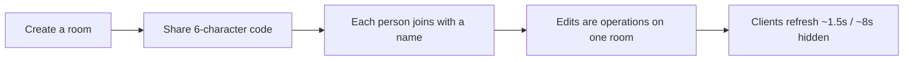

# TeamCompass — Product Documentation

**Status:** Current as of repository state 2026-11-11  
**Brand:** TeamCompass (UI, metadata, marketing copy)  
**Engineering namespace:** `@cadence/core`, `@cadence/web`, `@cadence/mobile`  
**Note:** On case-insensitive filesystems this path is also `docs/product.md`. There is a single product document—this one.

---

## 1. Product overview

TeamCompass is a **shared collaboration room** for three sprint rituals:

1. **Retrospective** — warm up, write privately, discuss, vote, own actions, export a summary  
2. **Sprint review** — walk a shared readiness checklist, collect feedback, record one release decision  
3. **Roadmap** — score initiatives with RICE, ICE, or value÷complexity, with complexity as a first-class lens  

People join with a **six-character room code**. There are **no accounts**. Everyone who has the code edits the same board. The **web app** is the full room experience and hosts the API. The **phone app** (Expo) joins the same rooms over the same HTTP API and shared domain package.

### Positioning statement

> TeamCompass helps teams align on direction, review progress, and decide what comes next—on one board, with one code, without accounts.

### Product benefits

| Benefit | What the product delivers |
| --- | --- |
| Fast room start | Create a ritual room in seconds; share a short code |
| Psychological safety in retros | Notes stay private on the server during brainstorm |
| Facilitation control | Host gates phase, icebreaker, discussion walk, and timers |
| Decision clarity | Review ends in ship / iterate / hold with notes |
| Honest roadmap math | Score and complexity sit on the same card; quadrants explain trade-offs |
| Cross-device parity | Web and mobile share `@cadence/core` rules and the same room document |
| Exportable outcomes | Retro summary downloads as CSV including timing and icebreaker data |

---

## 2. Who it is for

Primary users are agile product and engineering teams running time-boxed rituals. See [personas](./personas/) for Facilitator Maya, Contributor Jordan, and Stakeholder Priya.

---

## 3. Features

### 3.1 Rooms and presence

- Create a room by ritual kind (`retro` | `review` | `roadmap`), optional title, host name, and (for retros) template  
- Optional **demo** seed: 10 notes per retro column (every template), full professional review + 10-bet roadmap  
 
- Join by six-character code and display name  
- Local identity persisted in browser `localStorage` / mobile AsyncStorage (`person_…` id + name)  
- Presence: a participant is **active** if `lastSeen` is within **20 seconds** (`ACTIVE_MS`)  
- Host is the room creator (`hostId`); host-only operations are enforced in core  
- Hard cap: **40** participants per room  

### 3.2 Retrospective

**Phases (host-gated):** Icebreaker → Notes (brainstorm) → Discuss → Vote → Actions → Summary  

| Capability | Detail |
| --- | --- |
| Templates | 8 classic + 26 pop-culture shapes (34 total) from `RETRO_TEMPLATES` |
| Icebreaker | 18 games; host picks game; This or That supports host-written pairs (1–8) |
| Private notes | During brainstorm, `presentRoom` strips others’ note bodies before leaving the server |
| Discuss walks | Status walk (column) or author walk; board columns remain status categories |
| Dot voting | Default **3** votes per person (host sets **1–10**); lowering budget drops excess newest dots |
| Actions | Body, owner, done flag; can be created from a note |
| Timers | Per-section countdown; UI presets **3 / 5 / 8** minutes; server allows 30–3600 seconds |
| Stopwatch | Accrues while a section is open; Summary has no timer/stopwatch UI |
| Column glyphs | Header graphics grow as notes collect in that column |
| Summary + CSV | Collects notes, votes, actions, icebreaker answers, and section timing; downloadable CSV |

### 3.3 Sprint review

- Shared checklist seeded into four sections (increment, story, evidence, closing the loop)  
- Required items; multi-signer `doneBy` (idempotent desired-state checks)  
- Per-item evidence notes; custom items per section (cap **30** / section)  
- Sprint goal  
- Live feedback: praise / change / question  
- One release decision: **ship**, **iterate**, or **hold**, plus decision notes  
- Progress derived from required items checked  

### 3.4 Roadmap

- Framework switch: **RICE**, **ICE**, **value / complexity**  
- Initiatives with outcome, assumption, scores, complexity (technical / dependency / uncertainty), horizon (now / next / later), owner  
- Complexity index = average of the three 1–5 ratings (2 decimals)  
- Chart: score vs complexity; vertical guide at **HIGH_COMPLEXITY = 3.5**; horizontal guide at **median score**  
- Quadrants: do-first, big-bet, fill-in, reconsider  
- Insights (e.g. thin confidence when RICE confidence &lt; 0.6)  
- Ranked list with relative bar  

### 3.5 Platforms

| Surface | Role |
| --- | --- |
| Web (`apps/web`) | Full UI, App Router pages, room API, file/Redis store |
| Mobile (`apps/mobile`) | Expo client for home / create / room for all three rituals |
| Core (`packages/core`) | Types, ops, privacy presentation, scoring, content, export |

---

## 4. Product logics (business rules)

1. **Room code is the access key.** Anyone with the code and a name can join and edit (subject to host gates and phase rules).  
2. **One room document, versioned.** Each successful op bumps `version`. Clients poll (~1.5s visible / ~8s hidden) and ignore stale snapshots.  
3. **Desired-state votes and checks.** Sending “voting: true” or “done: true” is idempotent; a double tap does not toggle away the first intent.  
4. **Brainstorm privacy is server-side.** Hiding notes only in the browser is not considered private.  
5. **Host authority.** Only the host changes phase, icebreaker selection/pairs/rounds, and discussion walk mode.  
6. **Last write wins** on the same field when two people edit concurrently.  
7. **Text fields commit on blur or Enter** (single-line); failed saves restore previous text.  
8. **Scoring math lives in core** so web and mobile cannot diverge on formulas.  
9. **Hard limits** protect the single-process JSON store (see §7 and [GUARDRAILS](./GUARDRAILS.md)).  

Collaboration flow:

---

## 5. Scoring summary

Full definitions live in [VARIABLES.md](./VARIABLES.md).

| Framework | Formula |
| --- | --- |
| RICE | `(Reach × Impact × Confidence) / Effort` |
| ICE | `Impact × Confidence × Ease` (each 1–10) |
| Value / complexity | `Business value / complexity index` |

**Complexity index:**  
`round(((technical + dependency + uncertainty) / 3) × 100) / 100` with each input 1–5.

**Quadrants:** strong = score ≥ median; heavy = complexity ≥ 3.5.

**RICE example:** reach 400, impact 2, confidence 0.8, effort 2 → `(400 × 2 × 0.8) / 2 = 320`.

---

## 6. Business guidelines

- Position TeamCompass for **trusted-network** use (office LAN, VPN, team-owned server)—not as a multi-tenant SaaS with account security.  
- Do not market “private notes” without clarifying **server-enforced** brainstorm privacy and that the operator of the server can read stored JSON.  
- Prefer **facilitation clarity** over feature sprawl: each retro section shows only that section’s work.  
- Keep scoring frameworks **industry-familiar** (Intercom RICE, ICE, value/complexity) and document insight thresholds.  
- Treat **demo rooms** as marketing/onboarding aids, not production meeting records.  
- Mobile must always point at a reachable web API base URL; do not imply offline-first multiplayer.  

---

## 7. Technical guidelines (product-facing)

| Topic | Guideline |
| --- | --- |
| Stack | Next.js 15 + React 19 web; Expo ~58 mobile; TypeScript core; Vitest |
| Storage | Local `rooms.json` or Upstash Redis document + queue/lock ([DEPLOYMENT.md](./DEPLOYMENT.md)) |
| Sync | HTTP polling, not WebSockets |
| Auth | None beyond room code |
| Scaling | One Node process owns the file; do not run two writers against one store |
| Limits | 40 people, 180 cards, 80 actions, 40 initiatives, 100 feedback notes, etc. |
| CORS | Open (`*`) for local/LAN mobile access |
| Errors | Domain `CadenceError` with machine `code` (e.g. `host`, `phase`, `private`, `votes`) |

---

## 8. Tech stack snapshot

See [TECH_STACK.md](./TECH_STACK.md) for versions and scripts.

- **Web:** Next.js App Router, Instrument Sans, CSS design tokens  
- **Mobile:** Expo / React Native, shared colors in `src/ui.js`  
- **Core:** Pure TypeScript domain library  

---

## 9. Related documents

- [PRD](./PRD.md) · [Architecture](./ARCHITECTURE.md) · [API](./API.md) · [Variables](./VARIABLES.md) · [Guardrails](./GUARDRAILS.md) · [Design](./DESIGN_GUIDELINES.md) · [Changelog](./CHANGELOG.md) · [Index](./00-INDEX.md)
