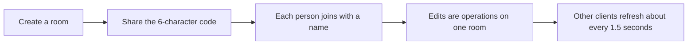

# Cadence

Cadence is the shared room a product team uses for the retrospective, the sprint review, and roadmap scoring. People join with a code. Everyone edits one board. The phone app and the web app talk to the same room.

## Rituals

### Retrospective

The host moves the room through five sections. Each section shows only its own work.

1. **Icebreaker.** A short warm-up game. Notes, dots, and actions stay out of this section.
2. **Notes.** People write into a classic template, such as start/stop/continue, 4Ls, mad/sad/glad, sailboat, rose/bud/thorn, went well/didn’t/puzzles, drop/add/keep/improve, or starfish. Pop-culture templates use the same kind of columns: Star Wars, superhero, arcade, premiere, quest, race weekend, Pokémon, heist, noir, concert, wizarding, streaming, Marvel, DC, Harry Potter, Breaking Bad, Criminal Minds, NCIS, One Piece, Naruto, Bleach, Lord of the Rings, Stranger Things, Avatar, Sherlock, and Squid Game. Every shape is one retrospective. The columns connect as decisions about this sprint and the next one: what to keep, what to stop, and what to try, with the longer shapes adding the in-between choices. Each column’s hint says which decision it is. Every column carries one graphic for that template, in the column header. The graphic grows as notes collect there. A note can be edited, moved, or removed here. You see only your own notes. Other people’s notes stay hidden until Discuss.
3. **Discuss.** Notes are revealed. The host chooses a status walk or an author walk. A status walk takes one column at a time. An author walk takes one person at a time, and that person’s notes stay grouped by status. The board columns remain the status categories. There is no voting and no action list in this section.
4. **Vote.** Each person places one dot on a limited number of notes. The default is three. The dot budget is set here. Lowering that limit removes the extra dots. Notes cannot be edited while voting.
5. **Actions.** An action has text, an owner, and a done check. It can be written fresh or started from a note. The columns and the vote buttons are not on this screen.

Each section has its own timer (3, 5, or 8 minutes) and its own stopwatch. Only the host can change the section.

### Sprint review

The checklist is the bar for “we are ready to show this.” Sections cover the increment, the story of the sprint, evidence, and closing the loop. Required items are marked. Checking an item records who checked it, so two people can both sign the same line.

Beside the list:

- the sprint goal
- live feedback marked praise, change, or question
- one release decision: **ship**, **iterate**, or **hold**, plus notes

### Roadmap

Each initiative has a business outcome, an assumption, an owner, a horizon (now / next / later), a score, and a complexity reading.

Complexity is the average of three 1–5 ratings:

- technical difficulty
- dependency load
- uncertainty

High complexity starts at 3.5. A strong score with high complexity is a big bet. A strong score with lower complexity is something to do first. A weak score with high complexity should be parked until the outcome is sharper.

The chart plots score against complexity. The vertical dashed line is high complexity at 3.5, and the horizontal dashed line is the median score used for the quadrants. The list is the accessible version of the same comparison.

## Scoring variables

### RICE

Formula: `(Reach × Impact × Confidence) / Effort`

| Variable | Range | Meaning |
| --- | --- | --- |
| Reach | 0–1,000,000 people or accounts | Who feels this in the quarter |
| Impact | 0.25, 0.5, 1, 2, 3 | Minimal, low, medium, high, massive. This is the Intercom scale. |
| Confidence | 0–1 | How sure the team is that the outcome will happen. Below 0.6, Cadence calls the confidence thin. |
| Effort | 0.25–240 person-months | Team time. The floor stops a tiny effort from exploding the score. |

Example: reach 400, impact 2, confidence 0.8, effort 2 → `(400 × 2 × 0.8) / 2 = 320`.

### ICE

Formula: `Impact × Confidence × Ease`

Each input is an integer from 1 to 10. Ease is how little friction there is to ship.

### Value / complexity

Formula: `Business value / complexity index`

Business value is 1–10. The complexity index is the average above. This view is for the conversation “is the outcome worth the difficulty,” without pretending effort and complexity are the same number.

## Collaboration

An edit is an operation: add a note, set a check, patch an initiative. The server applies it if the person has joined, bumps a version, and returns the room. Clients ignore a refresh that is older than the room they already show. Votes and checks send the desired state, so a double tap does not undo the first tap. This browser keeps the person who created or joined a room, and the next room you create uses that same person.

During a private brainstorm, the server removes other people’s note text before the response leaves. Hiding notes only in the browser would not be private.

Text fields keep what you are typing until you leave the field, or press Enter on a single line, then save. A failed save puts the previous text back. A newer update from someone else replaces the field when you are not editing it.

## Stack

- Web: Next.js, React, the room API
- Phone: Expo, React Native, the same API
- Shared rules: `packages/core`, tested with Vitest
- Storage: one JSON file on the web server, written by a single in-process queue

## Limits

- 40 people in a room, 180 retro notes, 80 actions, 40 initiatives, 100 feedback notes
- The room code is the only access control
- One Node process owns the file. Do not run two servers against one data file
- Last write wins when two people edit the same sentence
