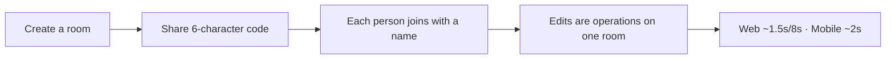

# TeamCompass — Product Documentation

**Status:** Current as of repository state 2026-11-20 (five rituals + retro PPT export)  
**Brand:** TeamCompass (UI, metadata, marketing copy)  
**Engineering namespace:** `@cadence/core`, `@cadence/web`, `@cadence/mobile`  
**Canonical path:** `docs/product.md` (use this casing in links for case-sensitive hosts).

---

## 1. Product overview

TeamCompass is a **shared collaboration room** for five sprint rituals:

1. **Retrospective** — warm up, write privately, discuss, vote, own actions, export a summary  
2. **Sprint planning** — set a Sprint Goal, let Developers forecast what can be Done, and plan how  
3. **Backlog refinement** — add detail, size, and order so an item can be selected later  
4. **Sprint review** — inspect the Increment with stakeholders and adapt the Product Backlog  
5. **Roadmap** — score initiatives with RICE, ICE, or value÷complexity, with complexity as a first-class lens  

People join with a **six-character room code**. There are **no accounts**. Everyone who has the code edits the same board. The **web app** is the full room experience and hosts the API. The **phone app** (Expo) joins the same rooms over the same HTTP API and shared domain package.

### Positioning statement

> TeamCompass helps teams align on direction, review progress, and decide what comes next—on one board, with one code, without accounts.

### Product benefits

| Benefit | What the product delivers |
| --- | --- |
| Fast room start | Create a ritual room in seconds; share a short code |
| Psychological safety in retros | Notes stay private on the server during brainstorm |
| Facilitation control | Host gates phase, icebreaker, and discussion walk; timers and vote budget are open on web |
| Decision clarity | Planning ends in commit / reshape / defer. Refinement ends in ready / split / park. Review ends in ship / iterate / hold. Each call keeps notes. |
| Honest roadmap math | Score and complexity sit on the same card; quadrants explain trade-offs |
| Cross-device parity | Web and mobile share `@cadence/core` rules and the same room document |
| Exportable outcomes | Retro summary downloads as **CSV** and as a consultant-style **PPT** (deck model in `@cadence/core`, rendered with `pptxgenjs` on web) |

---

## 2. Who it is for

Primary users are agile product and engineering teams running time-boxed rituals. See [personas](./personas/) for Facilitator Maya, Contributor Jordan, and Stakeholder Priya.

---

## 3. Features

### 3.1 Rooms and presence

- Create a room by ritual kind (`retro` | `planning` | `refinement` | `review` | `roadmap`), optional title, host name, and (for retros) template  
- Optional **demo** seed: 10 notes per retro column, checklist demos for planning / refinement / review, and 10 scored roadmap bets  
- Planning and refinement store their board in `room.review` via `createChecklistState(kind)` (same checklist ops as sprint review; decisions are kind-scoped)  
 
- Join by six-character code and display name  
- Local identity persisted in browser `localStorage` / mobile AsyncStorage (`person_…` id + name)  
- Presence: a participant is **active** if `lastSeen` is within **20 seconds** (`ACTIVE_MS`)  
- Host is the room creator (`hostId`); host-only operations are enforced in core  
- Hard cap: **40** participants per room  

### 3.2 Retrospective

**Phases (host-gated):** Icebreaker → Notes (brainstorm) → Discuss → Vote → Actions → Summary  

| Capability | Detail |
| --- | --- |
| Templates | **62** shapes in eight shelves (Classic 13 · Film 10 · Series 9 · Anime 5 · Games 9 · Sport 14 · Music 1 · Food 1). Listed A–Z per shelf. Column counts are **3, 4, or 5**. Search (`searchRetroTemplates`) matches name, blurb, column title, column count (`4`, `five columns`), or shelf. Filters narrow by shelf and column count on web and mobile create flows. |
| Icebreaker | **21** games; host picks game; This or That supports host-written pairs (1–8). **Health Check** (`scale`): six statements scored 1–7; peers see anonymized spreads and averages, not who chose each point. **Travel Wishlist** (`map`): 1–5 countries from a 175-country catalog; web interactive map with flag chips; mobile uses the same country list. **Lineup** (`order`): host names the lineup; each person orders every participant |
| Private notes | During brainstorm, `presentRoom` strips others’ note bodies before leaving the server |
| Health Check privacy | For other viewers, `presentRoom` replaces the answer author’s id with a synthetic `health-…` id so scores stay unattributed; CSV export author is `Anonymous` |
| Travel Wishlist | Body stores ISO country codes (comma-separated); summary/CSV expand to country **names**; web `travel-map.tsx` + `public/flags/*.svg` |
| Lineup | Host sets `icebreakerOrderTitle` (`retro.setOrderTitle`, max 80). Changing the title clears shared lineup answers. Each person submits every current participant id once (comma-separated). Web `people-order.tsx` (drag/reorder); mobile `PeopleOrderMobile`. CSV/summary → `1. Name, 2. Name` |
| Discuss walks | Status walk (column) or author walk; board columns remain status categories. A person can raise a hand; their named notes are highlighted. Anonymous notes stay unattributed. |
| Dot voting | Default **3** votes per person (budget **1–10** via web presets 1/2/3 or Custom); lowering budget drops excess newest dots. Any joined person can change the budget on web; mobile has no budget chrome |
| Actions | Body, owner, done flag; can be created from a note |
| Raise hand | In Discuss, anyone can raise/lower a hand (ordered queue). Named notes from that person highlight; anonymous notes stay unattributed except to the raiser |
| Timers | Per-section countdown; **web** presets **3 / 5 / 8** minutes plus Custom **1–60** whole minutes; server clamps 30–3600 seconds (mobile has no timer chrome) |
| Stopwatch | Accrues while a section is open; Summary has no timer/stopwatch UI |
| Column glyphs | Header graphics grow as notes collect in that column |
| Summary + CSV + PPT | Collects notes, votes, actions, icebreaker answers, and section timing; downloadable **CSV** and **PPT** (web Summary: `.summary-downloads*`) |

### 3.3 Sprint planning

Scrum Planning topics, each with a short “how to do it” for the room:

- **Why** — Product Owner proposes value. The Scrum Team writes a Sprint Goal. The goal is the commitment.  
- **What** — Developers pull items they believe they can bring to the Definition of Done. The selection is a forecast.  
- **How** — Developers plan the work, often in pieces of about a day. The plan is theirs.  
- **Sprint Backlog** — Sprint Goal + selected items + plan.  
- Calls: **Forecast**, **Narrow**, or **No goal**. A review decision such as Release is rejected.  

### 3.4 Product Backlog refinement

Ongoing backlog work, not a second planning event. Each part includes how to do it:

- **Detail** — user, outcome, acceptance criteria, open questions.  
- **Split** — if it cannot be Done in one Sprint, break it into a thin slice of value.  
- **Size** — Developers size it by comparison. The Product Owner does not set the size.  
- **Order** — Product Owner places it against its neighbors.  
- Calls: **Selectable**, **Split**, or **Return**. Selectable means Developers could pull it in Sprint Planning.  

### 3.5 Sprint review

Inspect and adapt, with how-to steps on each part:

- **Sprint Goal** — read the goal first and say whether it was met.  
- **Increment** — show only what meets the Definition of Done, along a user path.  
- **Stakeholders** — a working session. Ask what changed and what they would do next.  
- **Adapt the backlog** — Product Owner updates the Product Backlog before the room ends.  
- Calls: **Release**, **Adapt**, or **Hold** (stored as ship / iterate / hold).  

### 3.6 Roadmap

- Framework switch: **RICE**, **ICE**, **value / complexity**  
- Initiatives with outcome, assumption, scores, complexity (technical / dependency / uncertainty), horizon (now / next / later), owner  
- Complexity index = average of the three 1–5 ratings (2 decimals)  
- Chart: score vs complexity; vertical guide at **HIGH_COMPLEXITY = 3.5**; horizontal guide at **median score**  
- Quadrants: do-first, big-bet, fill-in, reconsider  
- Insights (e.g. thin confidence when RICE confidence &lt; 0.6)  
- Ranked list with relative bar  
- Inline link to roadmap Definitions (`/guide#guide-roadmap`)  

### 3.7 Definitions (cross-cutting)

Plain-English **variables**, **metrics**, and **formulas** for the rituals, shared from `@cadence/core` `GLOSSARY` (**31** entries across **5** groups: retro, planning, refinement, review, roadmap).

| Surface | Entry point |
| --- | --- |
| Web | `/guide` — linked from home, room chrome, and roadmap scoring model |
| Mobile | Home → **Definitions** → `Guide` screen (same `GLOSSARY` copy) |

Kinds: Variable (something the team enters) · Metric (a number the board calculates) · Formula (the math behind a metric). Engineering catalog remains [VARIABLES.md](./VARIABLES.md).

### 3.8 Platforms

| Surface | Role |
| --- | --- |
| Web (`apps/web`) | Full UI, App Router pages (`/`, `/new`, `/r/[code]`, `/guide`), room API, persistence (`file` / `supabase` / `redis`) |
| Mobile (`apps/mobile`) | Expo client: home / guide / create / room (2s poll; raise hand; no timer or vote-budget chrome) |
| Core (`packages/core`) | Types, ops, privacy, scoring, content (21 icebreakers + checklist rituals), **countries**, demo seed, CSV export, **retro deck** (`retrospectiveDeck`), **glossary** |
| Credit | Site-wide developer credit footer on web; home/create on mobile (`credit-footer`) |

---

## 4. Product logics (business rules)

1. **Room code is the access key.** Anyone with the code and a name can join and edit (subject to host gates and phase rules).  
2. **One room document, versioned.** Each successful op bumps `version`. Web polls ~1.5s visible / ~8s hidden; mobile polls ~2s. Clients ignore stale snapshots.  
3. **Desired-state votes and checks.** Sending “voting: true” or “done: true” is idempotent; a double tap does not toggle away the first intent.  
4. **Brainstorm privacy is server-side.** Hiding notes only in the browser is not considered private.  
5. **Host authority.** Only the host changes phase, icebreaker selection, This or That pairs, Lineup title (`setOrderTitle`), and discussion walk mode (not vote budget or timers). There is no host “next round” icebreaker op.  
6. **Last write wins** on the same field when two people edit concurrently.  
7. **Text fields commit on blur or Enter** (single-line); failed saves restore previous text.  
8. **Scoring math and Definitions copy live in core** so web and mobile cannot diverge on formulas or glossary text.  
9. **Hard limits** protect shared document stores (see §7 and [GUARDRAILS](./GUARDRAILS.md)).  
10. **Raise hand** is Discuss-only desired state; the queue clears whenever the host changes phase.  
11. **Host authority** covers phase, icebreaker (including pairs and Lineup title), and discuss walk—not vote budget or section timers (any joined actor may change those on web).  
12. **Health Check anonymity** is a peer-facing presentation rule: scores stay in the room document, but other clients never receive the real author id; CSV author is `Anonymous`.  
13. **Travel Wishlist** stores ISO country codes only from `TRAVEL_COUNTRIES` (max 5); export and summary expand codes to names.  
14. **Lineup** requires every current participant exactly once in the answer body; renaming the lineup clears previously shared orders so the room reorders under the new meaning.  

Collaboration flow:

---

## 5. Scoring summary

Full definitions live in [VARIABLES.md](./VARIABLES.md).

| Framework | Formula |
| --- | --- |
| RICE | `(Reach × Impact × Confidence) / Effort` |
| ICE | `Impact × Confidence × Ease` (each 1–10) |
| Value / complexity | `Business value / complexity index` |

**Complexity index:**  
`round(((technical + dependency + uncertainty) / 3) × 100) / 100` with each input 1–5.

**Quadrants:** strong = score ≥ median; heavy = complexity ≥ 3.5.

**RICE example:** reach 400, impact 2, confidence 0.8, effort 2 → `(400 × 2 × 0.8) / 2 = 320`.

---

## 6. Business guidelines

- Position TeamCompass for **trusted-network** use (office LAN, VPN, team-owned server)—not as a multi-tenant SaaS with account security.  
- Do not market “private notes” without clarifying **server-enforced** brainstorm privacy and that the operator of the server can read stored JSON.  
- Prefer **facilitation clarity** over feature sprawl: each retro section shows only that section’s work.  
- Keep scoring frameworks **industry-familiar** (Intercom RICE, ICE, value/complexity) and document insight thresholds.  
- Treat **demo rooms** as marketing/onboarding aids, not production meeting records.  
- Mobile must always point at a reachable web API base URL; do not imply offline-first multiplayer.  

---

## 7. Technical guidelines (product-facing)

| Topic | Guideline |
| --- | --- |
| Stack | Next.js 15 + React 19 web; Expo ~58 mobile; TypeScript core; Vitest |
| Storage | Preferred: local `rooms.json` on one Node process. Vercel: Supabase (`cadence_store`) or Upstash Redis ([DEPLOYMENT.md](./DEPLOYMENT.md)) |
| Sync | HTTP polling, not WebSockets (web visibility-aware; mobile fixed 2s) |
| Auth | None beyond room code |
| Scaling | File backend: one Node writer. Serverless: Supabase or Redis. Do not run two writers against one file |
| Limits | 40 people, 180 cards, 80 actions, 40 initiatives, 100 feedback notes, etc. |
| CORS | Open (`*`) for local/LAN mobile access |
| Errors | Domain `CadenceError` with machine `code` (e.g. `host`, `phase`, `private`, `votes`) |

---

## 8. Tech stack snapshot

See [TECH_STACK.md](./TECH_STACK.md) for versions and scripts.

- **Web:** Next.js App Router, Instrument Sans, CSS design tokens  
- **Mobile:** Expo / React Native, shared colors in `src/ui.js`  
- **Core:** Pure TypeScript domain library  

---

## 9. Related documents

- [PRD](./PRD.md) · [Architecture](./ARCHITECTURE.md) · [API](./API.md) · [Variables](./VARIABLES.md) · [Guardrails](./GUARDRAILS.md) · [Design](./DESIGN_GUIDELINES.md) · [Changelog](./CHANGELOG.md) · [Index](./00-INDEX.md)
